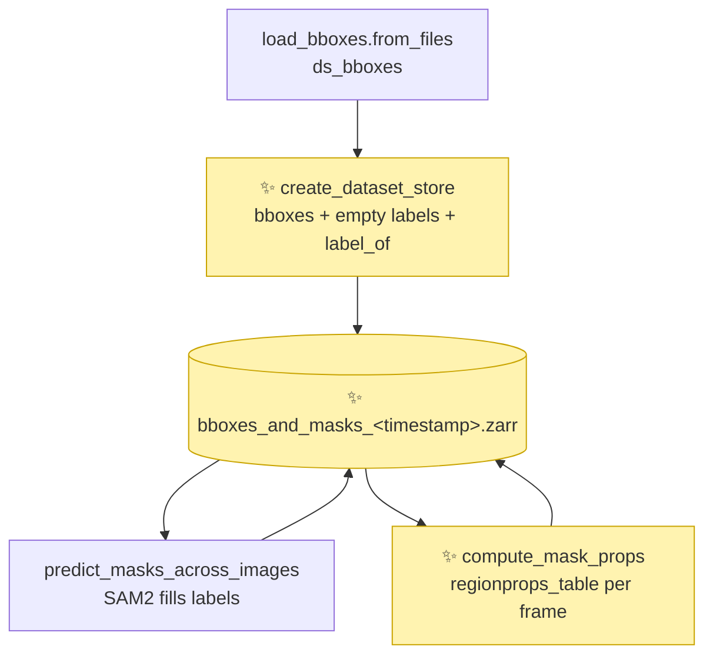
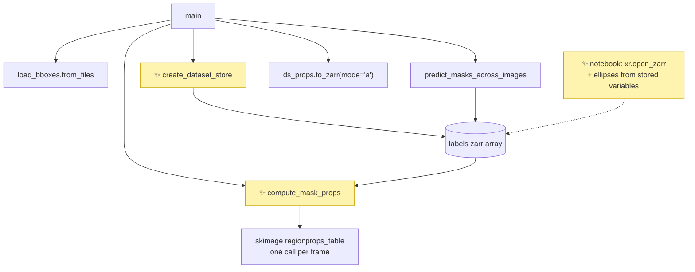

# Proposal for per-mask ellipse parameters in `generate_masks_from_bboxes.py`

## Description

The script writes one zarr store per run, holding the bounding boxes, the masks and a few shape
parameters per mask:

- the bounding boxes dataset `ds_bboxes` gains a `labels` variable, with one label image per
  frame, and a `label_of` variable;
- an ellipse is fitted to every mask, and its parameters are added as data variables on the same
  `(image_id, id)` grid as the boxes;
- the whole dataset lives in `bboxes_and_masks_<timestamp>.zarr`.

SAM2 writes the masks to the store, and the parameters are measured by reading them back.
This keeps measuring separate from SAM2, for the cost of reading one compressed chunk per frame.



Arrows point from what a step reads to the step, and from a step to what it writes.
✨ marks what is new in this PR.

- **load_bboxes.from_files** →
  [generate_masks_from_bboxes.py:302-306](https://github.com/SainsburyWellcomeCentre/crabs-exploration/blob/smg/gt-ellipses-prediction/scripts/generate_masks_from_bboxes.py#L302-L306)
- **predict_masks_across_images** →
  [generate_masks_from_bboxes.py:184](https://github.com/SainsburyWellcomeCentre/crabs-exploration/blob/smg/gt-ellipses-prediction/scripts/generate_masks_from_bboxes.py#L184)

## References

- [notebook_visualise_masks_from_zarr.py:49-100](https://github.com/SainsburyWellcomeCentre/crabs-exploration/blob/smg/gt-ellipses-prediction/notebooks/notebook_visualise_masks_from_zarr.py#L49-L100)
  — `ellipses_from_labels`, which draws these ellipses from `regionprops`; this PR replaces it.
- [notebook_visualise_masks_from_zarr.py:162-170](https://github.com/SainsburyWellcomeCentre/crabs-exploration/blob/smg/gt-ellipses-prediction/notebooks/notebook_visualise_masks_from_zarr.py#L162-L170)
  — the `labels` / `label_of` layout this PR writes to disk.
- [#293](https://github.com/SainsburyWellcomeCentre/crabs-exploration/pull/293) — *Add
  mask-tracked-crabs entry point*.
    - Its `create_mask_store` writes an xarray template with `compute=False`, then fills
      `labels` through zarr. This PR reuses that pattern.
- [#292](https://github.com/SainsburyWellcomeCentre/crabs-exploration/pull/292) — *Segment
  crabs with SAM2 after detection proposals*, which leaves ellipse fitting and orientation
  explicitly out of scope.
- [scikit-image `regionprops_table`](https://scikit-image.org/docs/0.25.x/api/skimage.measure.html#skimage.measure.regionprops_table)
  — the source of every parameter.
- [OCTRON-GUI](https://github.com/OCTRON-tracking/OCTRON-GUI) — uses the same
  `regionprops_table` properties, and always includes `label` and `centroid`.

## Overview of steps

1. Add `xarray`, `dask` and `scikit-image` to the script's inline dependencies.
2. Move the `sam2` and `ethology` imports into `main`, so that tests can import the script.
3. In `main`, cast the `space` coordinate to `object`, so that zarr 3 writes it without a
   warning.
4. Replace `create_mask_zarr` with `create_dataset_store`, which writes `ds_bboxes`, an empty
   `labels` variable and `label_of`, and returns the `labels` zarr array.
5. Leave `predict_masks_across_images` unchanged: it fills that `labels` array.
6. Add `compute_mask_props(labels_zarr, ds_bboxes)`, returning an `xr.Dataset` with one data
   variable per parameter, on `(image_id, id)`.
7. In `main`, append those data variables to the same store.
8. Update the module docstring with the store layout.
9. Update the notebook to read the new store and draw the stored ellipses.
10. Add three unit tests.

## Key aspects of suggested implementation

### 1. Eight parameters, all standard `regionprops_table` properties

Each parameter is one data variable, named after what it measures.

| Data variable | Dims | `regionprops_table` property | Meaning |
|---|---|---|---|
| `mask_centroid` | `(image_id, space, id)` | `centroid` | mean `(x, y)` of the mask pixels; also the ellipse centre |
| `mask_area` | `(image_id, id)` | `area` | number of mask pixels |
| `mask_area_to_convex_hull_area` | `(image_id, id)` | `solidity` | mask area / area of its convex hull; low for fragmented or leaky masks |
| `mask_area_to_mask_bbox_area` | `(image_id, id)` | `extent` | mask area / area of the mask's own axis-aligned bounding box. It should be highlighted in the relevant docstring that this is the mask's bounding box, not the prompt bounding box. |
| `ellipse_major_axis_length` | `(image_id, id)` | `axis_major_length` | full length of the major axis, in pixels |
| `ellipse_minor_axis_length` | `(image_id, id)` | `axis_minor_length` | full length of the minor axis, in pixels |
| `ellipse_major_axis_theta` | `(image_id, id)` | `orientation`, converted | angle of the major axis from the image x-axis, in radians. Theta should be defined in the relevant docstring as the angel described here. |
| `ellipse_eccentricity` | `(image_id, id)` | `eccentricity` | 0 for a circle, towards 1 for an elongated ellipse |

> [!NOTE]
> The *ellipse* here is the one with the same second moments as the mask.
> scikit-image defines `axis_major_length`, `axis_minor_length`, `orientation` and
> `eccentricity` from it.

- **The `mask_` and `ellipse_` prefixes say where a value comes from.**
    - `mask_` values are measured on the pixels.
    - `ellipse_` values describe the fitted ellipse.
- **Axis lengths are full lengths, not semi-axes.**
    - Verified against scikit-image 0.26: an ellipse with semi-axes 20 and 5 gives
      `axis_major_length` 40.2 and `axis_minor_length` 9.4.
- **`mask_centroid` is not the bounding box centre.**
    - The box `position` is the midpoint of the annotated box.
    - `mask_centroid` is the mean of the mask pixels.
    - They differ when the crab is asymmetric in its box, when the box is loose, or when part of
      the mask is hidden by another crab.
- **`mask_area_to_mask_bbox_area` depends on rotation.**
    - It divides by the mask's own axis-aligned box, not by the annotated box.
    - For one ellipse it falls from 0.84 at θ = 0 to 0.53 at θ = 45° (scikit-image 0.26), so
      read it together with `ellipse_major_axis_theta`.
- **`ellipse_eccentricity` equals `sqrt(1 - (minor / major)²)`**, checked to three decimals.
- **`perimeter` is left out, because its error depends on rotation as much as on shape.**
    - scikit-image estimates it from steps along the pixel boundary.
    - On the same ellipse (semi-axes 20 and 8) the error is +0.3 % at 0° and +3.6 % at 45°.
    - On an ellipse four times larger it is +4.2 % to +4.7 %, so a larger size does not remove
      the bias.
    - Crabs of similar size therefore still differ by a few per cent from rotation alone, and
      the jagged edges of SAM2 masks add to that.

### 2. The angle is measured from the image x-axis, in `[0, π)`

`ellipse_major_axis_theta` uses the same pixel coordinates as the rest of the dataset.

- `position` and `mask_centroid` are `(x, y)`, with x along columns and y down the rows.
- So `(cos θ, sin θ)` is the direction of the major axis in those same coordinates.
- matplotlib draws it with no conversion on an image axis:
  `Ellipse(xy, width, height, angle=np.degrees(θ))`.
    - Verified with matplotlib 3.10: `angle=45` on an `imshow` axis puts the major axis along
      `(+x, +y)`.

scikit-image's `orientation` is measured from the **row** axis, in `[-π/2, π/2]`, so
`compute_mask_props` converts it:

```python
ellipse_major_axis_theta = np.mod(np.pi / 2 - orientation, np.pi)
```

- **The angle grows from +x towards +y.**
    - The image y-axis points down, so a positive angle looks clockwise on screen.
- **The range is `[0, π)`, because an ellipse axis has no head or tail.**
- Verified against scikit-image 0.26 on synthetic masks:
    - a mask elongated along x has `orientation` 1.571, so θ is 0;
    - a mask elongated down-right along the diagonal has `orientation` 0.779, so θ is about π/4.

### 3. Each parameter sits at the `(image_id, id)` of its bounding box

Traceability needs no new index: a mask label already encodes the box position.

- `get_bboxes_mask_labels_per_frame` paints the mask of the box at position `k` along `id`
  with label `k + 1`
  ([generate_masks_from_bboxes.py:139](https://github.com/SainsburyWellcomeCentre/crabs-exploration/blob/smg/gt-ellipses-prediction/scripts/generate_masks_from_bboxes.py#L139)).
- `regionprops_table` returns that label in its `label` column, so `id` index = `label - 1`.
- ethology builds `id` as `range(max_annotations_per_image)`, so position and coordinate value
  are the same.
- `label_of (id)` records the mapping explicitly, as the notebook and
  [#293](https://github.com/SainsburyWellcomeCentre/crabs-exploration/pull/293) do.
- Slots with no box, or with an empty mask, stay `NaN`, exactly like `position` and `shape`.

```python
box = ds.sel(image_id=40, id=10)
box.position, box.shape                              # the bounding box
box.mask_centroid, box.mask_area                     # its mask
box.ellipse_major_axis_theta                         # its ellipse
ds.labels.sel(image_id=40) == box.label_of           # its mask pixels
```

### 4. One store, written in three passes

The store is an xarray dataset on disk, so every variable shares the `image_id` and `id`
coordinates.

```text
<data_dir>/annotations/bboxes_and_masks_<timestamp>.zarr
├── image_id, space, id               coordinates from ds_bboxes
├── position, shape, category, ...    (image_id, [space,] id)   from ethology
├── labels                            (image_id, img_h, img_w)  uint16, 0 = background
├── label_of                          (id,)                     uint16, label = id + 1
├── mask_centroid                     (image_id, space, id)     float64, NaN = no mask
└── mask_area, mask_area_to_convex_hull_area, mask_area_to_mask_bbox_area,
    ellipse_major_axis_length, ellipse_minor_axis_length,
    ellipse_major_axis_theta, ellipse_eccentricity
                                      (image_id, id)            float64, NaN = no mask
```

The three passes:

1. **Template.** `create_dataset_store` writes `ds_bboxes`, `label_of` and a lazy, all-zero
   `labels` with `to_zarr(..., compute=False)`.
    - With `compute=False`, xarray writes the metadata and every numpy-backed variable at once,
      but defers the dask-backed `labels`.
    - The deferred write is never run, so no chunk of zeros is written. SAM2 overwrites every
      frame anyway, and an unwritten chunk reads back as the fill value, 0.
    - Verified with xarray 2026.4 and zarr 3.2.1: after the template, `labels/` holds only its
      `zarr.json`, `position/` holds its chunks, and `labels` reads as 0.
    - It returns the `labels` array opened with zarr, one frame per chunk.
2. **Masks.** `predict_masks_across_images` writes into that array, exactly as it writes into
   the masks store today.
    - It only uses `.shape`, `.attrs` and slice assignment, which a zarr array in a group also
      has.
3. **Parameters.** `compute_mask_props` reads `labels` back and returns an `xr.Dataset`.
   `main` then calls `to_zarr(..., mode="a")`, which adds each of its data variables to the
   store as a new array.
    - Verified with xarray 2026.4 and zarr 3.2.1: the appended variables open alongside
      `labels` and `position`, and frames written through zarr keep their values.

- This is the pattern of `create_mask_store` in
  [#293](https://github.com/SainsburyWellcomeCentre/crabs-exploration/pull/293), so both mask
  stores read the same way.
- The run's metadata (`sam2_model`, `occlusion_policy`, …) moves from the array attributes to
  the dataset attributes.

### 5. Parameters are measured by reading the stored labels back

`compute_mask_props` reads `labels` back from the store, one frame at a time.

- **Reading back is cheap.** It costs one compressed `(H, W)` chunk per frame, against a SAM2
  forward pass per frame to write it.
- **The measurement stays out of the SAM2 batching loop**, so it can also run on stores that
  already exist.
- **The values are reproducible from the store alone**, and match what the notebook draws.
- **An occluded crab is measured on its visible pixels only.**
    - `labels` applies the *smallest wins* occlusion policy
      ([generate_masks_from_bboxes.py:168-181](https://github.com/SainsburyWellcomeCentre/crabs-exploration/blob/smg/gt-ellipses-prediction/scripts/generate_masks_from_bboxes.py#L168-L181)).

| Option | Why worse |
|---|---|
| Measure each frame inside `predict_masks_across_images`, from the label image already in memory | couples measurement to SAM2 batching; cannot rerun on an existing store |
| Measure the raw SAM2 masks, before *smallest wins* flattening | same coupling; values can no longer be reproduced from the store |
| Keep all label images in memory and measure at the end | an `(n_images, H, W)` uint16 array does not fit in memory for full datasets |

## Detailed implementation



Solid arrows point from a caller to what it calls, from a function to the array it writes, or
from an array to the function that reads it. The dashed arrow is the notebook reading the store.

- **main** →
  [generate_masks_from_bboxes.py:277](https://github.com/SainsburyWellcomeCentre/crabs-exploration/blob/smg/gt-ellipses-prediction/scripts/generate_masks_from_bboxes.py#L277)
- **predict_masks_across_images** →
  [generate_masks_from_bboxes.py:184](https://github.com/SainsburyWellcomeCentre/crabs-exploration/blob/smg/gt-ellipses-prediction/scripts/generate_masks_from_bboxes.py#L184)
- **create_dataset_store** → new, replaces `create_mask_zarr`
  ([generate_masks_from_bboxes.py:144-165](https://github.com/SainsburyWellcomeCentre/crabs-exploration/blob/smg/gt-ellipses-prediction/scripts/generate_masks_from_bboxes.py#L144-L165)).
- **compute_mask_props** → new, placed after `flatten_masks_smallest_wins`.
- **notebook** →
  [notebook_visualise_masks_from_zarr.py](https://github.com/SainsburyWellcomeCentre/crabs-exploration/blob/smg/gt-ellipses-prediction/notebooks/notebook_visualise_masks_from_zarr.py)

| # | Change | Signature or diff |
|---|---|---|
| 1 | Inline dependencies | `+ "xarray",`, `+ "dask",`, `+ "scikit-image",` in the `# /// script` block |
| 2 | Imports | `sam2` and `ethology` imported inside `main` |
| 3 | Replace `create_mask_zarr` | `def create_dataset_store(path_to_zarr, ds_bboxes, image_shape, metadata_dict) -> zarr.Array: ...` |
| 4 | New function | `def compute_mask_props(labels_zarr, ds_bboxes) -> xr.Dataset: ...` |
| 5 | `main` | new store name, `space` cast to `object`, `create_dataset_store`, append parameters; see diff in step 5 |
| 6 | Module docstring | the store layout from [Key aspect 4](#4-one-store-written-in-three-passes) |
| 7 | Notebook | read the store with `xr.open_zarr`; draw ellipses from the stored variables |
| 8 | Tests | `tests/test_unit/test_generate_masks_from_bboxes.py`, three tests |

<details><summary><b>Step 1 — dependencies</b></summary>

```diff
 # dependencies = [
 #   "Pillow",
 #   "zarr",
+#   "xarray",
+#   "dask",
+#   "scikit-image",
 #   "torch>=2.5.1",
```

- `xarray` already arrives through `ethology`; listing it is for the new direct import.
- `dask` makes the template's `labels` lazy, so `to_zarr` does not build a full array in memory.
- None is pinned, matching the rest of the block.

</details>

<details><summary><b>Step 2 — imports</b></summary>

`sam2` and `ethology` are not project dependencies, so a test cannot import the script while
they sit at module level. Only `main` uses them.

```diff
-from ethology.io.annotations import load_bboxes
-from sam2.sam2_image_predictor import SAM2ImagePredictor
 ...
 def main(args):
     """Generate masks from bbox annotations using SAM2."""
+    # imported here, so that tests can import this module without them
+    from ethology.io.annotations import load_bboxes
+    from sam2.sam2_image_predictor import SAM2ImagePredictor
+
```

- `torch`, `zarr`, `xarray`, `dask` and `scikit-image` stay at module level: the project
  environment already provides them (`scikit-image` through `sleap`).
- The ruff rules in `pyproject.toml` do not flag imports inside functions.

</details>

<details><summary><b>Step 3 — <code>create_dataset_store</code></b></summary>

ethology may set `Path` attributes, which zarr cannot store, so the function converts them.

- Read from the ethology source (local checkout at `aa6726b`), `load_bboxes.from_files` sets:
    - `annotation_files` and `images_directories` — may be `Path` objects;
    - `map_image_id_to_filename` and `map_category_to_str` — dicts with `int` keys.
- Verified with xarray 2026.4 and zarr 3.2.1:
    - a `Path` attribute makes `to_zarr` raise `TypeError: Invalid attribute in Dataset.attrs`;
    - `int` dict keys are written without error, but come back as strings, because JSON object
      keys are always strings.
- `_attrs_for_zarr` turns every `Path` into `str` and leaves the rest unchanged.
    - No writer-side change can keep `int` keys in a zarr attribute, so readers convert the
      keys back once after opening the store. The notebook then looks up `image_id` directly
      ([Step 7](#detailed-implementation)).

```python
def create_dataset_store(path_to_zarr, ds_bboxes, image_shape, metadata_dict):
    """Write ds_bboxes, an empty ``labels`` and ``label_of``; return ``labels``.

    The template is written with ``compute=False``: coordinates, metadata and
    the bbox variables go to disk, but no ``labels`` chunk does. The caller
    fills ``labels`` through the returned zarr array.
    """
    image_h, image_w = image_shape
    n_images = ds_bboxes.sizes["image_id"]

    ds = ds_bboxes.assign(
        labels=(
            ("image_id", "img_h", "img_w"),
            # lazy zeros, so to_zarr writes no data;
            # one dask chunk per frame, matching the zarr chunks
            da.zeros(
                (n_images, image_h, image_w),
                chunks=(1, image_h, image_w),
                dtype=np.uint16,
            ),
        ),
        # label k + 1 is the mask of the box at position k along `id`
        label_of=(
            "id",
            np.arange(1, ds_bboxes.sizes["id"] + 1, dtype=np.uint16),
        ),
    )
    ds.attrs = _attrs_for_zarr({**ds_bboxes.attrs, **metadata_dict})

    ds.to_zarr(
        path_to_zarr,
        mode="w",
        encoding={"labels": {"chunks": (1, image_h, image_w)}},
        compute=False,
    )
    return zarr.open_group(path_to_zarr)["labels"]


def _attrs_for_zarr(attrs):
    """Return a copy of ``attrs`` with every ``Path`` turned into ``str``."""
    def fix(value):
        if isinstance(value, Path):
            return str(value)
        if isinstance(value, dict):
            return {k: fix(v) for k, v in value.items()}
        if isinstance(value, list | tuple):
            return [fix(v) for v in value]
        return value
    return {key: fix(value) for key, value in attrs.items()}
```

- `metadata_dict` keeps today's keys.
    - `image_ids` and `image_filenames` become redundant with the `image_id` coordinate and
      `map_image_id_to_filename`; they are kept, because removing them is not needed here.
- `predict_masks_across_images` still writes `annotated_frames` onto the `labels` array
  attributes ([generate_masks_from_bboxes.py:272-274](https://github.com/SainsburyWellcomeCentre/crabs-exploration/blob/smg/gt-ellipses-prediction/scripts/generate_masks_from_bboxes.py#L272-L274)).

</details>

<details><summary><b>Step 4 — <code>compute_mask_props</code></b></summary>

```python
from skimage.measure import regionprops_table

# regionprops_table property -> data variable on (image_id, id)
PROPS_TO_VARS = {
    "area": "mask_area",
    "solidity": "mask_area_to_convex_hull_area",
    "extent": "mask_area_to_mask_bbox_area",
    "axis_major_length": "ellipse_major_axis_length",
    "axis_minor_length": "ellipse_minor_axis_length",
    "eccentricity": "ellipse_eccentricity",
}


def compute_mask_props(labels_zarr, ds_bboxes):
    """Measure each mask and its fitted ellipse, per (image_id, id).

    The ellipse is the one with the same second moments as the mask, as
    defined by scikit-image. Axis lengths are full lengths, not semi-axes.
    ``ellipse_major_axis_theta`` is the angle of the major axis from the
    image x-axis towards the y-axis, in radians, in [0, pi).
    ``mask_centroid`` is the mean (x, y) of the mask pixels. Slots with no
    mask are NaN.
    """
    n_images, n_ids = ds_bboxes.sizes["image_id"], ds_bboxes.sizes["id"]
    names = [*PROPS_TO_VARS.values(), "ellipse_major_axis_theta"]
    out = {name: np.full((n_images, n_ids), np.nan) for name in names}
    centroid = np.full((n_images, 2, n_ids), np.nan)  # space = ["x", "y"]

    for f in range(n_images):
        table = regionprops_table(
            np.asarray(labels_zarr[f]),
            properties=["label", "centroid", "orientation", *PROPS_TO_VARS],
        )
        # label k + 1 is the mask of the box at position k along `id`
        idx = table["label"] - 1
        for prop, name in PROPS_TO_VARS.items():
            out[name][f, idx] = table[prop]
        # scikit-image measures from the row axis; convert to the x-axis
        out["ellipse_major_axis_theta"][f, idx] = np.mod(
            np.pi / 2 - table["orientation"], np.pi
        )
        centroid[f, 0, idx] = table["centroid-1"]  # x = column
        centroid[f, 1, idx] = table["centroid-0"]  # y = row

    data_vars = {name: (("image_id", "id"), arr) for name, arr in out.items()}
    data_vars["mask_centroid"] = (("image_id", "space", "id"), centroid)
    return xr.Dataset(
        data_vars, coords=ds_bboxes[["image_id", "space", "id"]].coords
    )
```

- One frame is read at a time, so memory stays at one `(H, W)` label image.
- Rejected alternatives:

| Option | Why worse |
|---|---|
| `regionprops` objects, as the notebook does | one Python object per mask; `regionprops_table` returns arrays ready to index |
| One `mask_props` variable with a `prop` dimension | mixes units (pixels, pixels², radians, ratios) in one array |

</details>

<details><summary><b>Step 5 — <code>main</code></b></summary>

```diff
-    # Create output zarr store
+    # Output zarr store, holding bboxes, masks and mask parameters
     timestamp = datetime.now().strftime("%Y%m%d_%H%M%S")
-    output_masks_zarr = annotations_dir / f"masks_{timestamp}.zarr"
-    output_masks_zarr.mkdir(parents=True, exist_ok=True)
+    output_zarr = annotations_dir / f"bboxes_and_masks_{timestamp}.zarr"

     # Read groundtruth as ethology annotation dataset
     ds_bboxes = load_bboxes.from_files(
         annotations_file,
         format="COCO",
         images_dirs=images_dir,
     )
+    # zarr 3 has no stable format for numpy's fixed-width strings,
+    # so store the `space` coordinate as variable-length strings
+    ds_bboxes = ds_bboxes.assign_coords(space=ds_bboxes.space.astype(object))
 ...
-    mask_zarr = create_mask_zarr(
-        output_masks_zarr,
-        (n_images, image_h, image_w),
-        metadata_dict=metadata_dict,
-    )
+    labels_zarr = create_dataset_store(
+        output_zarr,
+        ds_bboxes,
+        (image_h, image_w),
+        metadata_dict=metadata_dict,
+    )
 ...
     predict_masks_across_images(
         image_predictor,
         image_array,
         map_frame_idx_to_boxes_and_labels,
-        mask_zarr,
+        labels_zarr,
         batch_size,
     )

-    print(f"Saved ID-encoded mask zarr to {output_masks_zarr}")
+    # Add mask and ellipse parameters per bbox, measured on the stored masks
+    ds_props = compute_mask_props(labels_zarr, ds_bboxes)
+    ds_props.to_zarr(output_zarr, mode="a")
+
+    print(f"Saved bboxes, masks and mask parameters to {output_zarr}")
```

</details>

<details><summary><b>Step 6 — module docstring</b></summary>

- Replace `<data_dir>/annotations/masks_<timestamp>.zarr` with
  `<data_dir>/annotations/bboxes_and_masks_<timestamp>.zarr`.
- Add the store layout from [Key aspect 4](#4-one-store-written-in-three-passes), the variable
  table from [Key aspect 1](#1-eight-parameters-all-standard-regionprops_table-properties) and
  the angle convention from
  [Key aspect 2](#2-the-angle-is-measured-from-the-image-x-axis-in-0-π).

</details>

<details><summary><b>Step 7 — notebook</b></summary>

The notebook opens the one store, so it no longer calls `load_bboxes`, `da.from_zarr` or
`regionprops`.

- **Removed:** `ellipses_from_labels`
  ([notebook_visualise_masks_from_zarr.py:49-100](https://github.com/SainsburyWellcomeCentre/crabs-exploration/blob/smg/gt-ellipses-prediction/notebooks/notebook_visualise_masks_from_zarr.py#L49-L100)),
  the `load_bboxes` cell (lines 103-109) and the masks cells (lines 143-170).
- **Changed:** `map_month_to_zarr` points at `bboxes_and_masks_<timestamp>.zarr` stores.

Loading, and getting everything for one box:

```python
# %%%%%%%%%%%%%%%%%%%%%%
# Read bboxes, masks and mask parameters from one store
ds = xr.open_zarr(DATA_DIR / "annotations" / map_month_to_zarr[MONTH])

# image paths, aligned with the image_id coordinate;
# zarr stores dict keys as strings, so convert them back to int once
images_dir = Path(ds.attrs["images_directories"])
map_id_to_filename = {
    int(k): v for k, v in ds.attrs["map_image_id_to_filename"].items()
}
img_paths = [
    images_dir / map_id_to_filename[img_id] for img_id in ds.image_id.values
]
# ... lazy `images` data variable built from img_paths, as today

# %%%%%%%%%%%%%%%%%%%%%%
# Bbox, mask and ellipse of one box, all at the same (image_id, id)
image_id, id = 40, 10
box = ds.sel(image_id=image_id, id=id)

box.position                          # bbox centre (x, y)
box.shape                             # bbox width, height
box.mask_centroid                     # mask centroid (x, y)
box.mask_area                         # mask area, in pixels
box.ellipse_major_axis_length         # full length, in pixels
box.ellipse_major_axis_theta          # radians, from +x towards +y
single_mask = ds.labels.sel(image_id=image_id) == box.label_of
```

Drawing that box's ellipse in the existing matplotlib cell:

```python
from matplotlib.patches import Ellipse

ax.add_patch(
    Ellipse(
        xy=box.mask_centroid.values,  # (x, y)
        width=float(box.ellipse_major_axis_length),
        height=float(box.ellipse_minor_axis_length),
        angle=np.degrees(float(box.ellipse_major_axis_theta)),
        fill=False,
        edgecolor="yellow",
    )
)
```

Drawing every ellipse in napari, replacing `ellipses_from_labels`:

```python
def ellipse_shapes_from_ds(ds):
    """Return napari ellipses, major axes and minor axes for every mask.

    Each shape is an array of points in (frame index, y, x) order.
    """
    f, k = np.nonzero(ds.mask_area.notnull().values)  # frame, id index
    cx = ds.mask_centroid.sel(space="x").values[f, k]
    cy = ds.mask_centroid.sel(space="y").values[f, k]
    a = ds.ellipse_major_axis_length.values[f, k][:, None] / 2
    b = ds.ellipse_minor_axis_length.values[f, k][:, None] / 2
    theta = ds.ellipse_major_axis_theta.values[f, k]

    # unit vectors in (y, x): major axis at theta from +x, minor at 90 deg
    u = np.stack([np.sin(theta), np.cos(theta)], axis=-1)
    v = np.stack([np.cos(theta), -np.sin(theta)], axis=-1)
    c = np.stack([cy, cx], axis=-1)

    corners = np.stack(
        [c + a * u + b * v, c + a * u - b * v,
         c - a * u - b * v, c - a * u + b * v], axis=1,
    )  # (N, 4, 2)
    major = np.stack([c - a * u, c + a * u], axis=1)  # (N, 2, 2)
    minor = np.stack([c - b * v, c + b * v], axis=1)  # (N, 2, 2)

    def with_frame(points):
        frame = np.broadcast_to(f[:, None, None], (*points.shape[:2], 1))
        return np.concatenate([frame, points], axis=-1)

    return with_frame(corners), with_frame(major), with_frame(minor)


ellipses, major_axes, minor_axes = ellipse_shapes_from_ds(ds)
# viewer.add_shapes(...) calls unchanged
```

- Stores written before this PR (`masks_<timestamp>.zarr`) do not open in the updated
  notebook; re-run the script to get a `bboxes_and_masks_<timestamp>.zarr` store.

</details>

<details><summary><b>Step 8 — tests</b></summary>

See [Tests](#tests).

</details>

## Files changed

| File | Change |
|---|---|
| `scripts/generate_masks_from_bboxes.py` | dependencies, imports in `main`, `create_dataset_store` (replaces `create_mask_zarr`), `_attrs_for_zarr`, `compute_mask_props`, `main`, docstring |
| `notebooks/notebook_visualise_masks_from_zarr.py` | read the store with `xr.open_zarr`; draw ellipses from the stored variables |
| `tests/test_unit/test_generate_masks_from_bboxes.py` | **new**, three unit tests |

## Tests

Yes: three unit tests, with no SAM2 and no real data.

- They import the script, which needs `sam2` and `ethology` to be imported inside `main`
  ([Step 2](#detailed-implementation)).
- They build a small `ds_bboxes` and label images by hand; no existing fixture fits.
- They run in the project environment, which has xarray 2026.4, zarr 3.2.1 and scikit-image 0.26.

Fixtures, in the new test file:

```python
@pytest.fixture
def ds_bboxes():
    """Two images, three id slots, with attributes as ethology sets them."""
    return xr.Dataset(
        {"position": (("image_id", "space", "id"), np.full((2, 2, 3), np.nan))},
        coords={
            "image_id": [5, 7],
            "space": np.array(["x", "y"], dtype=object),  # as main casts it
            "id": range(3),
        },
        attrs={
            "images_directories": Path("/data/frames"),
            "map_image_id_to_filename": {5: "a.png", 7: "b.png"},
        },
    )


@pytest.fixture
def labels():
    """(2, 100, 120) label images: id 0 in image 5, id 2 in image 7."""
    lab = np.zeros((2, 100, 120), np.uint16)
    rr, cc = ellipse(50, 60, 8, 20)  # semi-axes 8 (rows), 20 (cols)
    lab[0, rr, cc] = 1  # elongated along x
    # skimage.draw rotates from +x towards -y, so this is theta = pi / 4
    rr, cc = ellipse(50, 60, 8, 20, rotation=-np.pi / 4)
    lab[1, rr, cc] = 3
    return lab
```

1. **`test_compute_mask_props`** — values land at the right `(image_id, id)`, and are correct.

    ```python
    ds = compute_mask_props(labels, ds_bboxes)
    first = ds.sel(image_id=5, id=0)
    assert first.mask_area == (labels[0] == 1).sum()
    np.testing.assert_allclose(first.mask_centroid, [60, 50])  # (x, y)
    np.testing.assert_allclose(first.ellipse_major_axis_length, 40, rtol=0.05)
    np.testing.assert_allclose(first.ellipse_major_axis_theta, 0, atol=0.02)
    np.testing.assert_allclose(
        ds.ellipse_major_axis_theta.sel(image_id=7, id=2), np.pi / 4, atol=0.02
    )
    assert int(ds.mask_area.isnull().sum()) == 4  # every other slot
    ```

2. **`test_create_dataset_store`** — the template has zero `labels`, `label_of`, and
   zarr-safe attributes.

    ```python
    create_dataset_store(store, ds_bboxes, (100, 120), {"occlusion_policy": "smallest_wins"})
    ds = xr.open_zarr(store)
    assert int(ds.labels.max()) == 0
    assert list(ds.label_of.values) == [1, 2, 3]
    assert ds.attrs["images_directories"] == "/data/frames"
    assert ds.attrs["map_image_id_to_filename"] == {"5": "a.png", "7": "b.png"}
    assert ds.attrs["occlusion_policy"] == "smallest_wins"
    ```

3. **`test_store_round_trip`** — the three passes of `main`, without SAM2.

    ```python
    labels_zarr = create_dataset_store(store, ds_bboxes, (100, 120), {})
    labels_zarr[:] = labels  # what predict_masks_across_images does
    compute_mask_props(labels_zarr, ds_bboxes).to_zarr(store, mode="a")
    ds = xr.open_zarr(store)
    mask = ds.labels.sel(image_id=7) == ds.label_of.sel(id=2)
    assert int(mask.sum()) == ds.mask_area.sel(image_id=7, id=2)
    ```

## Documentation updates

Yes:

- the module docstring of `scripts/generate_masks_from_bboxes.py`
  ([Step 6](#detailed-implementation));
- `notebooks/notebook_visualise_masks_from_zarr.py`, which shows how to read the store
  ([Step 7](#detailed-implementation));
- the PR description, which must say that stores written before this PR
  (`masks_<timestamp>.zarr`) do not open in the updated notebook, and that the script must be
  re-run to get a `bboxes_and_masks_<timestamp>.zarr` store.

## Verifications for agent to run

1. **Lint:**
   `pre-commit run --files scripts/generate_masks_from_bboxes.py notebooks/notebook_visualise_masks_from_zarr.py tests/test_unit/test_generate_masks_from_bboxes.py`.
2. **Unit tests:** `pytest tests/test_unit/test_generate_masks_from_bboxes.py -v`.
3. **Run on real data** (SAM2 is slow on CPU; a GPU node is better):

    ```bash
    uv run scripts/generate_masks_from_bboxes.py /Users/sofia/swc/CrabLabels/aug2023-full
    ```

4. **Look at it:** point `map_month_to_zarr` at the new store, run the notebook, and check in
   matplotlib and napari that the ellipses sit on the crabs.

## Gotchas

| Detail | Consequence | Handling |
|---|---|---|
| ethology attributes may hold `Path` objects | `to_zarr` raises `TypeError` | `_attrs_for_zarr` turns them into `str` |
| ethology's `map_image_id_to_filename` has `int` keys | written without error, but read back with `str` keys | readers convert the keys to `int` once, as the notebook does |
| `labels` chunks are never written for frames with no box | they must read back as 0 | zarr returns the fill value, 0 for `uint16`; checked by `test_create_dataset_store` |
| The dask chunks of the template must match the zarr chunks | otherwise `to_zarr` refuses the encoding | both are `(1, H, W)` |
| ethology's `space` coordinate is a numpy fixed-width string (`<U1`), which has no stable zarr 3 format | `UnstableSpecificationWarning` on every write | `main` casts `space` to `object`, which zarr writes as variable-length strings; verified to remove the warning, and `.sel(space="x")` still works |
| zarr 3 flags consolidated metadata as outside its specification | `ZarrUserWarning` on every write | none: writing with `consolidated=False` removes it, but then every `xr.open_zarr` warns unless it passes `consolidated=False` too |
| A mask split into disconnected pieces is still one label | one ellipse spans all pieces | none; `mask_area_to_convex_hull_area` is low for these |
| A box whose mask is empty, or fully hidden by a smaller mask | no region for that label | parameters stay `NaN` |
| Masks of one or two pixels | `ellipse_minor_axis_length` is 0 and θ is arbitrary | none; filter on `mask_area` downstream |
| Stores written before this PR are a bare array | they do not open in the updated notebook | re-run the script; the PR description says so |

## Points to discuss

| # | To discuss | Conclusion |
|---|---|---|
| 1 | **The parameter list.** Which `regionprops_table` properties to store, and under which names. | Eight variables plus `label_of`, as in [Key aspect 1](#1-eight-parameters-all-standard-regionprops_table-properties). `eccentricity` and `extent` are included; `solidity` and `extent` get explicit names. `perimeter` is left out: its error depends on rotation (+0.3 % to +3.6 % on the same ellipse). |
| 2 | **Label image or raw SAM2 masks?** Measuring the stored label image keeps measuring separate from SAM2 and reproducible from the store, but an occluded crab is measured on its visible part only. | Measure the stored label image, read back from the store, as in [Key aspect 5](#5-parameters-are-measured-by-reading-the-stored-labels-back). |
| 3 | **Angle convention.** `[0, π)` from +x towards +y, which looks clockwise on screen. Alternatives: negate it to look counter-clockwise, or store scikit-image's `orientation` unchanged. | `[0, π)` from +x towards +y, stored as `ellipse_major_axis_theta`, because it matches the image pixel coordinates of `position` and `mask_centroid`. |
| 4 | **One store or two?** Bboxes, masks and parameters could go to one store, or masks could stay in their own store. | One store: `bboxes_and_masks_<timestamp>.zarr`, as in [Key aspect 4](#4-one-store-written-in-three-passes). We do this for simplicity. |
| 5 | **Unit tests.** Importing the script also imports `sam2` and `ethology`, which are not project dependencies. | Three unit tests in this PR, as in [Tests](#tests); the `sam2` and `ethology` imports move into `main`. |
| 6 | **Notebook update.** `notebook_visualise_masks_from_zarr.py` loads masks with `da.from_zarr`, which cannot open the new store. | Updated in this PR: it reads the store with `xr.open_zarr` and draws ellipses from the stored variables, as in [Step 7](#detailed-implementation). |
| 7 | **ethology version.** The script installs the latest `ethology`; the attribute types in [Gotchas](#gotchas) were read from a local checkout (`aa6726b`). The first real run confirms them. | |
