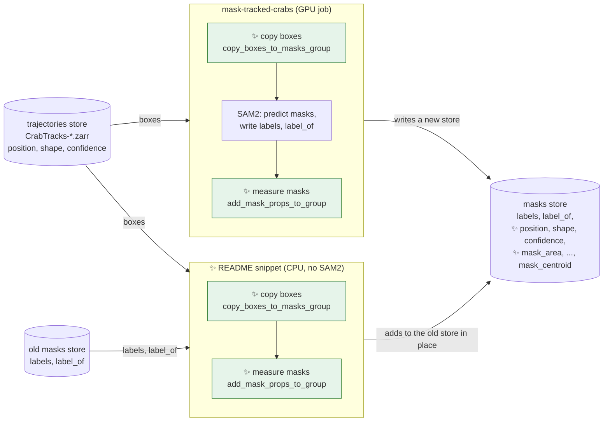
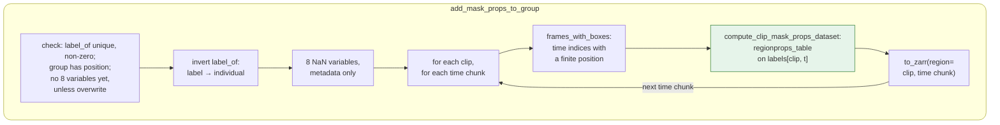

# Proposal for adding the mask parameters to the tracked masks store

## Description

`mask-tracked-crabs` runs SAM2 to mask tracked bboxes, and writes a zarr store with the prompt boxes, the masks and the 8 mask and ellipse
parameters of PR [#298](https://github.com/SainsburyWellcomeCentre/crabs-exploration/pull/298).

It does so following closely PR #298:

- It copies the tracked boxes into each masks group when it creates the store.
- It runs SAM2 and writes the label images (this functionality is already implemented, it was PR [#293](https://github.com/SainsburyWellcomeCentre/crabs-exploration/pull/293)).
- It measures the masks from the store and writes the 8 variables next to the boxes.

The work suggested in this proposal includes a short snippet in `crabs/mask/README.md` to support generating the same output zarr store from an "old" mask store (the old `CrabMasks`  mask store would be generated by running `mask-tracked-crabs` today).



Arrows outside the boxes show data read and written. Arrows inside the boxes are steps, in order.
✨ and green mark what is new in this PR.

- Both paths call the same two new functions, so both produce a masks store in the same format.
- The snippet skips SAM2: an old masks store already has `labels` and `label_of`.


In code, `main()` of `mask-tracked-crabs` gains four calls
([mask_video.py:432](https://github.com/SainsburyWellcomeCentre/crabs-exploration/blob/main/crabs/mask/mask_video.py#L432)):

```diff
     for node in video_nodes:
         ...
         image_shape, n_frames = _get_frame_shape_and_max_frames_in_video(clip_paths)
+        _check_clip_lengths(ds_video, clip_paths)                   # clip videos long enough
         labels_array = create_mask_store(...)
+        copy_boxes_to_masks_group(store_path, video_id, ds_video)   # boxes into the masks group
         ...
         for clip_index, clip_id in enumerate(clip_ids):
             ...
             write_clip_masks_to_store(...)                          # SAM2, unchanged
+
+        add_mask_props_to_group(store_path, video_id)               # the 8 variables
+
+    zarr.consolidate_metadata(store_path)                           # once, at the end
```

Links from the diagram:

- *SAM2: predict masks*: `main()`, the function behind `mask-tracked-crabs`, in
  [mask_video.py:432](https://github.com/SainsburyWellcomeCentre/crabs-exploration/blob/main/crabs/mask/mask_video.py#L432)

> [!NOTE]
> Terms used throughout:
>
> - **SAM2**: Segment Anything Model 2, the segmentation model that `mask-tracked-crabs` runs,
>   prompted with each tracked box.
> - **trajectories store**: `CrabTracks-*.zarr`, written by `create-zarr-dataset` from the
>   tracker's CSV files.
> - **masks store**: written by `mask-tracked-crabs`. On the cluster it is
>   `CrabMasks-slurm<array job ID>.zarr`, named by `run_mask_array.sh`
>   ([run_mask_array.sh:41](https://github.com/SainsburyWellcomeCentre/crabs-exploration/blob/main/bash_scripts/run_mask_array.sh#L41)).
>   Without an explicit name it is `<boxes-stem>_masks_<timestamp>.zarr`
>   ([mask_video.py:492](https://github.com/SainsburyWellcomeCentre/crabs-exploration/blob/main/crabs/mask/mask_video.py#L492)).
> - **old masks store**: a masks store written before this PR, with only `labels` and `label_of`.
> - **video group**: one zarr group per video, in both stores, named by `video_id`. It holds all
>   the clips of that video, along `clip_id`. Each clip has frames along `time` and tracked crabs
>   along `individual`.
> - **label image**: one `uint16` image per frame, in the masks store's `labels`. Each crab's
>   pixels hold its label, and 0 is background. `label_of` maps each `individual` to its label.
> - **consolidation**: `zarr.consolidate_metadata` copies the metadata of every group and array
>   into the store's root `zarr.json`, so opening the store reads one file instead of hundreds.
>   The copy is a snapshot: groups or variables added after it stay hidden from readers that use
>   it, with no error. More in [§4](#4-old-masks-stores-get-the-same-output-from-a-snippet).

## References

- PR [#293](https://github.com/SainsburyWellcomeCentre/crabs-exploration/pull/293) (merged into
  `main`): `mask-tracked-crabs`, which reads the trajectories store and writes the masks store.
- PR [#298](https://github.com/SainsburyWellcomeCentre/crabs-exploration/pull/298) (merged into
  `main`): the 8 variables, for annotated boxes, in
  `scripts/generate_masks_from_bboxes.py`.
- PR [#285](https://github.com/SainsburyWellcomeCentre/crabs-exploration/pull/285) (merged):
    - entry points live in `crabs/<feature>/`;
    - standalone scripts live in `scripts/`, and do not depend on `crabs`.
- Branch `smg/add-ellipse-params-to-tracks`, currently equal to `main` at `d005d99`.


## Overview of steps

1. Declare `scikit-image` as a dependency of `crabs` in `pyproject.toml`.
2. Add `copy_boxes_to_masks_group` to `crabs/mask/utils/boxes_from_dataset.py`.
3. Add `crabs/mask/mask_props.py`, with the measuring code of PR
   [#298](https://github.com/SainsburyWellcomeCentre/crabs-exploration/pull/298) and
   `add_mask_props_to_group`.
4. Call both functions in `mask-tracked-crabs`.
5. Record the mask config values of the run in each masks group's attributes.
    - In the bash script for the cluster `run_mask_array.sh`, we currently copy the mask YAML config file across. When we run the pipeline locally, we don't store the config. By saving it as a zarr store attribute we have a more compact solution that applies in both cases.
6. Add unit tests, including one that checks the measuring code agrees with the script of PR
   [#298](https://github.com/SainsburyWellcomeCentre/crabs-exploration/pull/298).
7. Document briefly and succinctly the new variables, the new attribute and the snippet for old masks stores in
   `crabs/mask/README.md`.

## Key aspects of suggested implementation

### 1. `mask-tracked-crabs` builds the store in the order of PR #298

`mask-tracked-crabs` follows the steps of `main()` in `scripts/generate_masks_from_bboxes.py` (from PR [#298](https://github.com/SainsburyWellcomeCentre/crabs-exploration/pull/298)
([generate_masks_from_bboxes.py:539](https://github.com/SainsburyWellcomeCentre/crabs-exploration/blob/main/scripts/generate_masks_from_bboxes.py#L539))),
for each video group:

| Step | PR #298 | `mask-tracked-crabs` |
|---|---|---|
| 1. Create the store with the boxes, empty `labels`, `label_of` and the run's attributes | `create_dataset_store` ([:226](https://github.com/SainsburyWellcomeCentre/crabs-exploration/blob/main/scripts/generate_masks_from_bboxes.py#L226)) | `create_mask_store`, then ✨ `copy_boxes_to_masks_group`. See why we cannot use `create_dataset_store` below this table. |
| 2. Run SAM2 on the box prompts and write `labels` | `predict_masks_across_images` ([:310](https://github.com/SainsburyWellcomeCentre/crabs-exploration/blob/main/scripts/generate_masks_from_bboxes.py#L310)) | `write_clip_masks_to_store`, per clip, unchanged. It does the SAM2 prediction, flattens the masks and saves the data. This is existing code from PR [#293](https://github.com/SainsburyWellcomeCentre/crabs-exploration/pull/293), not shared with the script. |
| 3. Measure the stored masks and append the 8 variables | `compute_mask_props_dataset` and `append_mask_props` ([:630](https://github.com/SainsburyWellcomeCentre/crabs-exploration/blob/main/scripts/generate_masks_from_bboxes.py#L630)) | ✨ `add_mask_props_to_group`, after the video's last clip |

Note that `mask-tracked-crabs` cannot call `create_dataset_store` directly:

- `crabs` cannot import it. `scripts/` is not part of the installed package
  ([pyproject.toml:112](https://github.com/SainsburyWellcomeCentre/crabs-exploration/blob/main/pyproject.toml#L112)),
  and PR [#285](https://github.com/SainsburyWellcomeCentre/crabs-exploration/pull/285) keeps
  scripts and `crabs` independent.
- `create_dataset_store` writes the layout of an **annotated** store: one group, with `(image_id, id)` dims. A **tracked** masks store
  has one group per video, with `(clip_id, time, individual)` dims.
- `create_dataset_store` writes with `mode="w"`, which replaces the whole store
  ([generate_masks_from_bboxes.py:285](https://github.com/SainsburyWellcomeCentre/crabs-exploration/blob/main/scripts/generate_masks_from_bboxes.py#L285)).
  The tasks of a `run_mask_array.sh` array each write their own video group into one store, so
  `create_mask_store` takes `zarr_mode_group` instead
  ([mask_video.py:151](https://github.com/SainsburyWellcomeCentre/crabs-exploration/blob/main/crabs/mask/mask_video.py#L151)).

Two design choices are made in the table's steps 1 and 3:

**Step 1: the boxes are written by a new, separate function.** In PR #298, `create_dataset_store`
writes the boxes as part of creating the store. Here the new code that writes the boxes goes in
its own function, `copy_boxes_to_masks_group`, rather than inside `create_mask_store`. This way
the snippet for old masks stores ([§4](#4-old-masks-stores-get-the-same-output-from-a-snippet))
can call it on a group that already exists.

**Step 3: the masks are measured from the store, after the video's last clip.** This is what
PR #298 does, so the values can be reproduced from the store alone
([generate_masks_from_bboxes.py:438](https://github.com/SainsburyWellcomeCentre/crabs-exploration/blob/main/scripts/generate_masks_from_bboxes.py#L438)). Here, it additionally allows the snippet to call the same function on old masks stores.

- Cost: about 3.6 h of CPU time per video, added to the GPU job. Today's longest job takes 44 h,
  and the limit is 120 h
  ([run_mask_array.sh:9](https://github.com/SainsburyWellcomeCentre/crabs-exploration/blob/main/bash_scripts/run_mask_array.sh#L9)).
- The estimate is 0.12 s per frame (on a laptop), times the 107,548 frames with boxes of the sample
  video `04.09.2023-01-Right`. Measuring logs its time per clip, so the first cluster run shows
  the real cost.

Options considered for when to measure the masks:

| Option | Comment |
|---|---|
| ✅ Measure inside `mask-tracked-crabs`, from the store, after each video | Chosen, to match the order of PR [#298](https://github.com/SainsburyWellcomeCentre/crabs-exploration/pull/298). Cost: CPU time in a GPU job. |
| A separate entry point, run after `mask-tracked-crabs` | Two commands to get the store of PR #298. The masks store is incomplete until the second runs. |
| Measure each label image in memory, while SAM2 writes it | Values not reproducible from the store. Old masks stores need different code. |

### 2. The masks group gains the boxes and the 8 variables

```text
<CrabMasks>.zarr/<video_id>/                       # existing video group
├── labels      (clip_id, time, img_h, img_w)      uint16       # existing
├── label_of    (individual,)                      uint16       # existing
├── ✨ position, shape  (clip_id, time, space, individual) float32     # copied boxes
├── ✨ confidence       (clip_id, time, individual)        float32     # copied boxes
├── ✨ mask_area                      (clip_id, time, individual) float32
├── ✨ mask_area_to_convex_hull_area  (clip_id, time, individual) float32
├── ✨ mask_area_to_mask_bbox_area    (clip_id, time, individual) float32
├── ✨ ellipse_major_axis_length      (clip_id, time, individual) float32
├── ✨ ellipse_minor_axis_length      (clip_id, time, individual) float32
├── ✨ ellipse_major_axis_theta       (clip_id, time, individual) float32
├── ✨ ellipse_eccentricity           (clip_id, time, individual) float32
├── ✨ mask_centroid                  (clip_id, time, space, individual) float32
└── attrs: timestamp, sam2_model, boxes, occlusion_policy, ...     # existing, kept
          ✨ mask_config                                             # config values of the run
```

The copied boxes:

- are a snapshot of the prompts the masks were predicted from;
- keep the float32 and the chunks of the trajectories store;
- are reindexed to the masks group's `time`, padded with NaN where it is longer.
  - Why the two lengths
  can differ: the trajectories store takes `time` from the clip metadata
  ([create_dataset.py:84](https://github.com/SainsburyWellcomeCentre/crabs-exploration/blob/main/crabs/zarr/create_dataset.py#L84)),
  the masks store from the clip videos
  ([mask_video.py:405](https://github.com/SainsburyWellcomeCentre/crabs-exploration/blob/main/crabs/mask/mask_video.py#L405)).

Two checks make sure no box is dropped without an error:

- ✨ `_check_clip_lengths`, in `mask-tracked-crabs`, raises before anything is written **if a clip
  video has fewer frames than its metadata length**. Otherwise SAM2 would stop at the video's last
  frame, and the later boxes would get no mask. It reads only the video headers.
- `copy_boxes_to_masks_group` raises **if a box falls past the end of the masks group's `time`**. This
  covers the snippet, which has no videos to check.

The 8 variables:

- have the names, meanings and angle convention of PR
  [#298](https://github.com/SainsburyWellcomeCentre/crabs-exploration/pull/298), defined in the
  docstring of `compute_mask_props_dataset`
  ([generate_masks_from_bboxes.py:434](https://github.com/SainsburyWellcomeCentre/crabs-exploration/blob/main/scripts/generate_masks_from_bboxes.py#L434)).
  For example, `ellipse_major_axis_theta` is in radians, in [0, π), from the image x-axis towards
  the y-axis;
- are float32, like the copied boxes they sit next to. PR #298 writes float64
  ([generate_masks_from_bboxes.py:478](https://github.com/SainsburyWellcomeCentre/crabs-exploration/blob/main/scripts/generate_masks_from_bboxes.py#L478)),
  which matches the float64 boxes of annotated stores
  ([Points to discuss #3](#points-to-discuss));
- are NaN where there is no mask;
- are chunked like the copied box variables with the same dims:
  - the 7 scalar variables like
  `confidence` `(clip_id, time, individual)`, which is `(1, 1000, 538)` in the sample store;
  -  `mask_centroid` like `position`, which also has `space`.

The 8 variables need no new attribute. The group's attributes already record the run:
`sam2_model`, `timestamp`, `occlusion_policy`, and `boxes.file`, the trajectories store the boxes
came from
([mask_video.py:519](https://github.com/SainsburyWellcomeCentre/crabs-exploration/blob/main/crabs/mask/mask_video.py#L519)).
The one new attribute, `mask_config`, records the config values of the run
([§6](#6-the-masks-group-records-the-mask-config-and-the-yaml-copy-goes)).

Each box and its 8 variables sit at the same `(clip_id, time, individual)` position, because:

- the masks group has the same `clip_id` and `individual` coordinates as the trajectories store,
  copied when the group is created
  ([mask_video.py:517](https://github.com/SainsburyWellcomeCentre/crabs-exploration/blob/main/crabs/mask/mask_video.py#L517));
- `label_of` gives each individual's mask label
  ([mask_video.py:128](https://github.com/SainsburyWellcomeCentre/crabs-exploration/blob/main/crabs/mask/mask_video.py#L128)).
  Measuring inverts it, from label to position along `individual`, and writes the values
  measured for each label at that position. It does not assume `label_of[k] = k + 1`, although
  that holds in today's stores.

Options considered:

| Option | Why worse |
|---|---|
| ✅ Boxes and 8 variables in the masks store | Chosen: one store, as in PR [#298](https://github.com/SainsburyWellcomeCentre/crabs-exploration/pull/298). Cost: the boxes are copied once per masks run, about 160 MB per video (4.3 GB for the 27 videos of the sample trajectories store). |
| The 8 variables in the trajectories store | Changes a shared store in place. Parameters from different masks runs replace each other. |
| The 8 variables in the masks store, without the boxes | Every analysis opens both stores and aligns them. |

### 3. The measuring code is copied from the script, and a test keeps both in agreement

> [!NOTE]
> **What is a PEP 723 header**: a comment block at the top of a Python script that lists its dependencies,
> so `uv run script.py` builds an environment for it without installing the project.

`crabs/mask/mask_props.py` gets its own copy of the measuring code of `compute_mask_props_dataset`
([generate_masks_from_bboxes.py:479](https://github.com/SainsburyWellcomeCentre/crabs-exploration/blob/main/scripts/generate_masks_from_bboxes.py#L479)),
about 40 lines.

- We need this duplication to keep the script self-contained. The script has a PEP 723 header, and does not depend on `crabs`, as set by PR
  [#285](https://github.com/SainsburyWellcomeCentre/crabs-exploration/pull/285).
- `crabs` cannot import the script: `scripts/` is not part of the installed package.

The copied code is:

- `PROPS_TO_VARS`, the property list
  ([generate_masks_from_bboxes.py:120](https://github.com/SainsburyWellcomeCentre/crabs-exploration/blob/main/scripts/generate_masks_from_bboxes.py#L120)),
  and the `regionprops_table` call;
- the angle conversion, `np.mod(np.pi / 2 - orientation, np.pi)`, from scikit-image's row axis to
  the x-axis that `position` and `shape` use;
- the centroid, swapped from (row, column) to (x, y);
- the NaN arrays, filled at each label's individual. PR #298 finds the individual as
  `label - 1`
  ([generate_masks_from_bboxes.py:491](https://github.com/SainsburyWellcomeCentre/crabs-exploration/blob/main/scripts/generate_masks_from_bboxes.py#L491));
  the copy looks it up in the inverse of `label_of`, which gives the same position whenever
  `label_of[k] = k + 1`.

A unit test runs the copy and `compute_mask_props_dataset` on the same label images, and checks
that all 8 variables are equal, with one `xr.testing.assert_allclose` ([Tests](#tests)). Its
default tolerance (`rtol=1e-5`) covers the float32 rounding of the copy. The test
imports the script as `scripts.generate_masks_from_bboxes`, as
`test_generate_masks_from_bboxes.py` already does.

Options considered:

| Option | Why worse |
|---|---|
| ✅ Copy, with a test that compares the two | Chosen. |
| The script imports `crabs`, with `crabs @ git+...` in its PEP 723 header | The script then installs every `crabs` dependency, such as `sleap[nn]`, `lightning` and `mlflow`, next to its own `pytorch-cu128` torch ([generate_masks_from_bboxes.py:86](https://github.com/SainsburyWellcomeCentre/crabs-exploration/blob/main/scripts/generate_masks_from_bboxes.py#L86)). Undoes PR [#285](https://github.com/SainsburyWellcomeCentre/crabs-exploration/pull/285). |
| Write a small shared package that both the script and `crabs` can depend on | A new package to release, for about 40 lines. |

### 4. Old masks stores get the same output from a snippet

> [!NOTE]
> **What is consolidation, what does it do**:
>
> - **Without consolidation:** a zarr store keeps each group's and each array's metadata in its own small
>   `zarr.json` file, holding things like shape, chunks, dtype, dims and attributes. Opening the
>   store means finding and reading all of those files. Each video group in the masks store has
>   about 15 arrays and coordinates, and the store has 27 groups, so that's hundreds of small reads.
>   On a network filesystem like ceph, each read is slow.
> - **What does consolidation do:** `zarr.consolidate_metadata` reads all those files and copies their contents
>   into the root `zarr.json`, under a `consolidated_metadata` key. Opening the store then needs
>   only that one file. It doesn't touch any data chunks, so it's fast.
> - **The catch:** the copy is a snapshot. If a group or variable is added later and nobody
>   consolidates again, the copy is out of date. `xr.open_zarr` and `xr.open_datatree` use the copy
>   whenever it exists. So an out-of-date copy hides the new groups and variables, and no error is
>   raised. That's why the last consolidation has to come after the last metadata change.
> - **One more caveat:** zarr warns that consolidated metadata isn't yet part of the zarr v3 spec.
>   Other zarr implementations may ignore it. Readers that ignore it just read the individual
>   files, so they still get correct results, only more slowly.

`crabs/mask/README.md` gives a snippet that calls the two functions `mask-tracked-crabs` calls, on
each group of an old masks store:

```python
import xarray as xr
import zarr

from crabs.mask.mask_props import add_mask_props_to_group
from crabs.mask.utils.boxes_from_dataset import copy_boxes_to_masks_group

masks_store = "CrabMasks-slurm<array job ID>.zarr"
trajectories_store = "CrabTracks-slurm3644250.zarr"  # each group's boxes.file attribute

dt_tracks = xr.open_datatree(trajectories_store, engine="zarr")
for video_id in xr.open_datatree(masks_store, engine="zarr").children:
    copy_boxes_to_masks_group(masks_store, video_id, dt_tracks[video_id].to_dataset())
    add_mask_props_to_group(masks_store, video_id)
zarr.consolidate_metadata(masks_store)
```

- It runs on CPU, with no SAM2. The run time is the measuring time above, about 3.6 hours per
  video.
- It is the same code as `mask-tracked-crabs`, so the output is the same, except for the
  `mask_config` attribute
  ([§6](#6-the-masks-group-records-the-mask-config-and-the-yaml-copy-goes)).
- `copy_boxes_to_masks_group` checks that `clip_id` and `individual` match, so a wrong
  trajectories store fails before anything is written.

### 5. `scikit-image` becomes a declared dependency

`scikit-image` is installed today only because `sleap` depends on it. `uv.lock` already pins 0.26.0,
so the lock file changes only in its list of `crabs`' direct dependencies.

```diff
 dependencies = [
     ...
     "xarray",
+    "scikit-image",  # regionprops for mask and ellipse parameters
 ]
```

### 6. The masks group records the mask config, and the YAML copy goes

`mask-tracked-crabs` writes the 4 config values it ran with into each masks group's attributes,
under `mask_config`:

```diff
             metadata_dict={
                 "timestamp": timestamp,
                 "sam2_model": sam2_model_id,
                 ...
                 "prompt_type": "bounding_box",
+                "mask_config": {
+                    "sam2_model_id": sam2_model_id,
+                    "max_prompts_per_batch": max_prompts_per_batch,
+                    "n_frames_per_shard": n_frames_per_shard,
+                    "occlusion_policy": occlusion_policy,
+                },
             },
```

- The 4 values are every key of `mask_config.yaml`
  ([mask_config.yaml](https://github.com/SainsburyWellcomeCentre/crabs-exploration/blob/main/crabs/mask/config/mask_config.yaml)).
  So the attributes hold everything the YAML file holds, except its comments. The comments stay in
  the default config file in the repo.
- They are the values the run used: the file's values, with the defaults set in `main()` for any key
  the file leaves out
  ([mask_video.py:444](https://github.com/SainsburyWellcomeCentre/crabs-exploration/blob/main/crabs/mask/mask_video.py#L444)).
  A config file may set only the keys that differ from the defaults
  ([README.md:34](https://github.com/SainsburyWellcomeCentre/crabs-exploration/blob/main/crabs/mask/README.md#L34)),
  so a copy of the file can miss values.
- Every run records them, whether started by `run_mask_array.sh` or by hand.
- `n_frames_per_shard: null`, for no sharding, is stored as JSON `null`. Verified by writing and
  reading back a nested dict with `None`, with xarray 2026.4.0 and zarr 3.2.1.
- `sam2_model` and `occlusion_policy` stay as top-level attributes too, so new stores keep every
  attribute of old ones.
- `copy_boxes_to_masks_group` and `add_mask_props_to_group` copy the group's attributes before
  writing, so `mask_config` is kept ([Gotchas](#gotchas)).

`run_mask_array.sh` stops copying the YAML file into the store
([run_mask_array.sh:167](https://github.com/SainsburyWellcomeCentre/crabs-exploration/blob/main/bash_scripts/run_mask_array.sh#L167)):

```diff
-# -------------------------------------------
-# Copy mask config to output store
-# -------------------------------------------
-cp "$MASK_CONFIG_FILE" "$MASK_ZARR_STORE_OUTPUT"/"$VIDEO_ID"_mask_config.yaml
-
-echo "Copied $MASK_CONFIG_FILE to $MASK_ZARR_STORE_OUTPUT"
```

- Today each array task copies the file to `<store>/<video_id>_mask_config.yaml`, one identical
  copy per video.
- The script still prints the config file into the job's `.out` log
  ([run_mask_array.sh:148](https://github.com/SainsburyWellcomeCentre/crabs-exploration/blob/main/bash_scripts/run_mask_array.sh#L148)),
  which is moved into `<store>/logs/`.
- The script installs `crabs` from `main`
  ([run_mask_array.sh:50](https://github.com/SainsburyWellcomeCentre/crabs-exploration/blob/main/bash_scripts/run_mask_array.sh#L50)),
  so both changes reach the cluster together, when this PR is merged.
- Old masks stores keep their YAML copies. The snippet of
  [§4](#4-old-masks-stores-get-the-same-output-from-a-snippet) does not add `mask_config`, since
  those copies are the only record of the run's config.

Options considered:

| Option | Why worse |
|---|---|
| ✅ The values the run used, in the attributes; no YAML copy | Chosen. |
| Keep copying the YAML file in `run_mask_array.sh` | Only cluster runs record the config. A file that sets only some keys does not record the defaults used. `max_prompts_per_batch` and `n_frames_per_shard` are not in the attributes. |
| The YAML file's contents, as loaded, in the attributes | Keys the file leaves out are missing. A misspelt key is recorded as if it were used. |

## Detailed implementation

`mask-tracked-crabs` gains four calls in `main`:

```diff
     for node in video_nodes:
         ...
         image_shape, n_frames = _get_frame_shape_and_max_frames_in_video(clip_paths)
+        _check_clip_lengths(ds_video, clip_paths)
         labels_array = create_mask_store(...)
+        copy_boxes_to_masks_group(store_path, video_id, ds_video)
         ...
         for clip_index, clip_id in enumerate(clip_ids):
             ...
             write_clip_masks_to_store(...)
+
+        add_mask_props_to_group(store_path, video_id)
+
+    zarr.consolidate_metadata(store_path)  # after every write of this run
```

Re `zarr.consolidate_metadata`, every other write and read of the masks store during the run skips consolidated metadata
([Consolidating once, at the end](#detailed-implementation)):

- writes pass `consolidated=False`, so only the final call consolidates;
- reads pass `consolidated=False` (xarray) or `use_consolidated=False` (zarr), so they see the
  group as it is on disk.

`add_mask_props_to_group` runs in this order:



The outer rounded box is the function; the square boxes inside it are its steps. Arrows are the order things happen
in. All boxes are new in this PR; green marks the step that copies the measuring code of PR
[#298](https://github.com/SainsburyWellcomeCentre/crabs-exploration/pull/298). The checks run
before anything is written.

Links from the diagram:

- *compute_clip_mask_props_dataset*: copies the measuring code of `compute_mask_props_dataset`,
  [generate_masks_from_bboxes.py:434](https://github.com/SainsburyWellcomeCentre/crabs-exploration/blob/main/scripts/generate_masks_from_bboxes.py#L434)

| # | Change | Signature |
|---|---|---|
| 1 | Declare the dependency | `"scikit-image"` in `[project] dependencies` |
| 2 | Copy one video's boxes into its masks group | `copy_boxes_to_masks_group(store_path: Path, video_id: str, ds_video: xr.Dataset) -> None`, in `crabs/mask/utils/boxes_from_dataset.py` |
| 3 | Measure one label image | `measure_label_frame(label_frame: np.ndarray) -> dict[str, np.ndarray]` |
| 4 | Frames of a clip that have boxes | `frames_with_boxes(ds_clip: xr.Dataset) -> np.ndarray` |
| 5 | Measure one time chunk of a clip | `compute_clip_mask_props_dataset(labels_array: zarr.Array \| np.ndarray, clip_index: int, time_slice: slice, frames: np.ndarray, individual_of_label: np.ndarray) -> xr.Dataset` |
| 6 | Measure one masks group and write the 8 variables | `add_mask_props_to_group(store_path: Path, video_id: str, overwrite: bool = False) -> None` |
| 7 | Raise if a clip video is shorter than its metadata length | `_check_clip_lengths(ds_video: xr.Dataset, clip_paths: list[Path]) -> None`, in `crabs/mask/mask_video.py` |
| 8 | Call 2, 6 and 7 in `mask-tracked-crabs`, and consolidate once at the end | four lines in `main` ([mask_video.py:511](https://github.com/SainsburyWellcomeCentre/crabs-exploration/blob/main/crabs/mask/mask_video.py#L511), [mask_video.py:557](https://github.com/SainsburyWellcomeCentre/crabs-exploration/blob/main/crabs/mask/mask_video.py#L557)) |
| 10 | Skip consolidated metadata in `create_mask_store` | `consolidated=False` on its `to_zarr`, and `use_consolidated=False` on its `zarr.open_group` ([mask_video.py:148](https://github.com/SainsburyWellcomeCentre/crabs-exploration/blob/main/crabs/mask/mask_video.py#L148), [mask_video.py:156](https://github.com/SainsburyWellcomeCentre/crabs-exploration/blob/main/crabs/mask/mask_video.py#L156)) |
| 9 | Record the config values of the run, and drop the YAML copy | `"mask_config": {...}` in `metadata_dict` ([mask_video.py:519](https://github.com/SainsburyWellcomeCentre/crabs-exploration/blob/main/crabs/mask/mask_video.py#L519)); 6 lines removed from `run_mask_array.sh` ([§6](#6-the-masks-group-records-the-mask-config-and-the-yaml-copy-goes)) |

Items 3–6 are in `crabs/mask/mask_props.py`. It imports nothing from `mask_video.py`, so
`mask_video.py` can import it.

<details><summary><b>Copying the boxes</b></summary>

`copy_boxes_to_masks_group` follows `append_mask_props`: it drops coordinates and copies the
group's attributes before `to_zarr(mode="a")`, because that call replaces them
([generate_masks_from_bboxes.py:518](https://github.com/SainsburyWellcomeCentre/crabs-exploration/blob/main/scripts/generate_masks_from_bboxes.py#L518)).

```python
def copy_boxes_to_masks_group(store_path, video_id, ds_video):
    ds_masks = xr.open_zarr(store_path, group=video_id, consolidated=False)
    IF clip_id or individual differ between ds_video and ds_masks: raise ValueError
    IF not np.array_equal(ds_video.time, np.arange(ds_video.sizes["time"])): raise ValueError
    IF any finite position at time >= ds_masks.sizes["time"]: raise ValueError
    chunks = dict(zip(ds_video.confidence.dims, ds_video.confidence.encoding["chunks"]))
    ds_boxes = (ds_video[["position", "shape", "confidence"]]
                .reindex(time=ds_masks.time)                       # pad or cut
                .drop_encoding()                                   # chunks set explicitly
                .chunk(chunks)
                .drop_vars(["clip_id", "time", "individual"]))    # keep the new `space`
    ds_boxes.attrs = ds_masks.attrs
    ds_boxes.to_zarr(store_path, group=video_id, mode="a", consolidated=False)
```

- `reindex` matches the two stores by `time` value. In both, `time` is the frame index within the
  clip, from 0: `np.arange(n_frames)` in `create_mask_store`
  ([mask_video.py:136](https://github.com/SainsburyWellcomeCentre/crabs-exploration/blob/main/crabs/mask/mask_video.py#L136)),
  and `np.arange(n_clip_frames)` per clip in `create-zarr-dataset`
  ([create_dataset.py:105](https://github.com/SainsburyWellcomeCentre/crabs-exploration/blob/main/crabs/zarr/create_dataset.py#L105)).
  That is the pairing the SAM2 prompts already use. The dense-`time` check guards stores built
  before PR [#291](https://github.com/SainsburyWellcomeCentre/crabs-exploration/pull/291), which
  the snippet could otherwise misalign without an error.
- The boxes are read lazily from the trajectories store, and streamed chunk by chunk. That store
  is not written during the run, so reading it may use its consolidated metadata.

</details>

<details><summary><b>Consolidating once, at the end</b></summary>

`mask-tracked-crabs` consolidates the masks store once, at the end of `main`. Every other write
and read of the masks store skips consolidated metadata.

- **Writes pass `consolidated=False`.**
    - `to_zarr`'s default re-consolidates the whole store at its root, on every non-region write
      (`consolidate_on_close = consolidated or consolidated is None`, read in the xarray 2026.4.0
      source, `xarray/backends/writers.py:661`).
    - Each consolidation reads the metadata of every node in the store, up to about 27 × 15 files
      on ceph, then rewrites the root. The final consolidation replaces all of them.
    - `zarr.consolidate_metadata` reads all nodes, then writes the root, with no lock. So an
      intermediate consolidation in one task can leave out another task's new group or variables.
    - zarr 3.2.1 writes each metadata file atomically (a temporary file, then a rename), so the
      root `zarr.json` is never half-written.
    - Region writes already skip consolidation: `to_zarr(region=...)` defaults to `mode="r+"`
      (`xarray/backends/writers.py:659`).
- **Reads pass `consolidated=False` (xarray) or `use_consolidated=False` (zarr).**
    - Opening one group still uses the root's consolidated metadata, if there is one. Verified
      with xarray 2026.4.0 and zarr 3.2.1: a variable added with `consolidated=False` after the
      last consolidation is missing from `xr.open_zarr(store, group=...)`, and a new group raises
      `KeyError` in `zarr.open_group(store)[...]`.
    - So with a stale root, `add_mask_props_to_group` would not find the copied `position`, and
      `create_mask_store` would not find its own `labels`
      ([mask_video.py:156](https://github.com/SainsburyWellcomeCentre/crabs-exploration/blob/main/crabs/mask/mask_video.py#L156)).
    - The root is stale whenever another task, or an earlier run, consolidated it before this
      task's write. This happens today too, with the default consolidation.
    - Each read then opens only that group's metadata files, about 15 per open, and 2 or 3 opens
      per task.
- **The final `zarr.consolidate_metadata(store_path)`** runs at the end of `main` in every task.
  When the last task of the array reaches it, every other task has finished its metadata writes,
  so its root is complete and nothing overwrites it
  ([Points to discuss #5](#points-to-discuss)).

`create_mask_store` changes in two lines:

```diff
     ds.to_zarr(
         store_path,
         group=video_id,
         mode=zarr_mode_group,
         encoding=encoding,
         compute=False,
+        consolidated=False,
     )

-    return zarr.open_group(store_path)[f"{video_id}/labels"]
+    return zarr.open_group(store_path, use_consolidated=False)[f"{video_id}/labels"]
```

While the array runs, a new store has no consolidated metadata until the first task finishes.
Readers that open it meanwhile read every metadata file: slower, and xarray warns, but the result
is correct.

</details>

<details><summary><b>Measuring</b></summary>

`measure_label_frame` returns one array per property, one value per label found:

```python
def measure_label_frame(label_frame):
    table = regionprops_table(label_frame,
                              properties=["label", "centroid", "orientation", *PROPS_TO_VARS])
    out = {"label": table["label"]}
    out |= {var: table[prop] for prop, var in PROPS_TO_VARS.items()}
    out["ellipse_major_axis_theta"] = np.mod(np.pi / 2 - table["orientation"], np.pi)
    out["mask_centroid_x"] = table["centroid-1"]          # x = column
    out["mask_centroid_y"] = table["centroid-0"]          # y = row
    RETURN out
```

- `regionprops_table` skips label 0, so the background needs no extra code.

`frames_with_boxes` returns the `time` indices where any individual has a finite `position`, read
from the masks group:

```python
any_box = ds_clip.position.notnull().any(dim=["space", "individual"])
RETURN np.flatnonzero(any_box.values)
```

- `mask-tracked-crabs` runs SAM2 only on frames with boxes, and leaves every other frame as
  background
  ([mask_video.py:342](https://github.com/SainsburyWellcomeCentre/crabs-exploration/blob/main/crabs/mask/mask_video.py#L342)).
  So no other frame needs reading.
- It returns the same frames as the keys of the existing `extract_bboxes_from_clip`
  ([boxes_from_dataset.py:11](https://github.com/SainsburyWellcomeCentre/crabs-exploration/blob/main/crabs/mask/utils/boxes_from_dataset.py#L11)),
  which builds the SAM2 prompts. That function is not reused here:
    - it reads `clip_first_frame_0idx`, `clip_last_frame_0idx` and `escape_state`, which the masks
      group does not have
      ([boxes_from_dataset.py:94](https://github.com/SainsburyWellcomeCentre/crabs-exploration/blob/main/crabs/mask/utils/boxes_from_dataset.py#L94));
    - it builds corner boxes and IDs for every frame, and measuring needs only the frame indices.

`compute_clip_mask_props_dataset` measures one time chunk of one clip. It places each value at its
individual with `individual_of_label`, the inverse of `label_of`, built once per group by
`add_mask_props_to_group`:

```python
individual_of_label = np.full(label_of.max() + 1, -1)          # -1: not a crab's label
individual_of_label[label_of.values] = np.arange(label_of.sizes["individual"])
```

For example, `label_of = [1, 2, 3]` gives `individual_of_label = [-1, 0, 1, 2]`, so label 2 goes
to the individual at position 1.

```python
n_chunk = time_slice.stop - time_slice.start
n_individuals = individual_of_label.max() + 1
arrays = {var: np.full((n_chunk, n_individuals), np.nan, dtype=np.float32) FOR EACH scalar var}
centroid = np.full((n_chunk, 2, n_individuals), np.nan, dtype=np.float32)
FOR EACH t IN frames:                                 # frames with boxes, inside time_slice
    props = measure_label_frame(np.asarray(labels_array[clip_index, t]))
    IF any props["label"] is past the end of individual_of_label, or maps to -1: raise ValueError
    i, k = t - time_slice.start, individual_of_label[props["label"]]
    FOR EACH scalar var: arrays[var][i, k] = props[var]
    centroid[i, 0, k] = props["mask_centroid_x"]
    centroid[i, 1, k] = props["mask_centroid_y"]
RETURN xr.Dataset(
    {var: (("time", "individual"), arrays[var]) FOR EACH scalar var}
    | {"mask_centroid": (("time", "space", "individual"), centroid)}
)                                                     # no coordinates
```

- It takes `labels_array: zarr.Array | np.ndarray`, as the script does, so the agreement test can
  pass a numpy array.
- A label in an image that is not in `label_of` raises, so no value is written to the wrong
  individual.
- A box with an empty mask gets NaN. This happens when SAM2 predicts no pixels, or under the
  `smallest_wins` occlusion policy, when a crab is entirely covered by a smaller one
  ([mask_video.py:241](https://github.com/SainsburyWellcomeCentre/crabs-exploration/blob/main/crabs/mask/mask_video.py#L241)).
- scikit-image measures in float64; the values are rounded to float32 as they are stored in the
  arrays.
- Memory per time chunk: 9 arrays of `n_chunk × n_individuals` float32. With the sample store's
  chunks of 1,000 frames that is 9 × 1,000 × 792 × 4 bytes, about 29 MB.
- This differs from PR
  [#298](https://github.com/SainsburyWellcomeCentre/crabs-exploration/pull/298), which fills
  arrays for the whole store and writes them once
  ([generate_masks_from_bboxes.py:477](https://github.com/SainsburyWellcomeCentre/crabs-exploration/blob/main/scripts/generate_masks_from_bboxes.py#L477)).
  Measuring a whole clip at once would take about 0.85 GB for the sample video, since
  `individual` is padded to 792 slots and about 90% of the values are NaN. The measured values
  are the same either way.

</details>

<details><summary><b>Writing the 8 variables</b></summary>

`add_mask_props_to_group` raises an error, before writing, if:

- `label_of` has a repeated value, or a 0 (the background label);
- the group has no `position`, i.e. the boxes were not copied;
- any of the 8 variables already exists, and `overwrite` is `False`.

It then creates the 8 variables as dask arrays with `to_zarr(compute=False)`, so only metadata is
written, as `create_mask_store` does
([mask_video.py:148](https://github.com/SainsburyWellcomeCentre/crabs-exploration/blob/main/crabs/mask/mask_video.py#L148)).
The group's attributes are copied into that dataset, as in `copy_boxes_to_masks_group`.

- It opens the group with `consolidated=False` and `labels` with `use_consolidated=False`.
- The `compute=False` write passes `consolidated=False`
  ([Consolidating once, at the end](#detailed-implementation)).

Each time chunk of each clip is then written with one region write:

```python
FOR EACH time_slice IN the time chunks of confidence:
    ds_props = compute_clip_mask_props_dataset(labels_array, clip_index, time_slice, ...)
    ds_props.expand_dims("clip_id").to_zarr(
        store_path, group=video_id,
        region={"clip_id": slice(clip_index, clip_index + 1), "time": time_slice},
    )
```

- Each region is one chunk along `clip_id` and `time`, and the whole `individual` axis, so it
  covers whole chunks.
- About 30 region writes per clip for the sample video. Their cost is small next to
  `regionprops_table`.
- Region writes change no metadata.
- One log line per clip gives the measuring time, next to the existing SAM2 log lines
  ([mask_video.py:544](https://github.com/SainsburyWellcomeCentre/crabs-exploration/blob/main/crabs/mask/mask_video.py#L544)).

`overwrite=True` is for the snippet: rerunning it after a crash replaces the 8 variables, and
leaves the copied boxes as they are.

</details>

## Files changed

| File | Change |
|---|---|
| `crabs/mask/mask_props.py` | **new**, about 150 lines: measuring code and `add_mask_props_to_group` |
| `crabs/mask/utils/boxes_from_dataset.py` | `copy_boxes_to_masks_group` |
| `crabs/mask/mask_video.py` | `_check_clip_lengths`, four calls in `main`, `mask_config` in the group attributes, and no consolidated metadata in `create_mask_store` |
| `bash_scripts/run_mask_array.sh` | no longer copies the YAML file into the store |
| `pyproject.toml` | `scikit-image` in `dependencies` |
| `uv.lock` | `scikit-image` listed as a direct dependency of `crabs` |
| `tests/test_unit/test_mask_props.py` | **new** ([Tests](#tests)) |
| `tests/test_unit/test_boxes_from_dataset.py` | tests of `copy_boxes_to_masks_group` |
| `tests/test_unit/test_mask_video.py` | `test_main` checks the boxes and the 8 variables |
| `crabs/mask/README.md` | *Output store format* gains the new variables; new section with the snippet for old masks stores |

## Tests

Yes: unit tests on small synthetic stores, with no SAM2 and no video.

<details><summary><b>Unit tests</b></summary>

Fixtures and helpers to reuse:

- `trajectories_store_and_clips`, built from `clip_dataset_factory` and `concat_clips`
  ([test_mask_video.py:124](https://github.com/SainsburyWellcomeCentre/crabs-exploration/blob/main/tests/test_unit/test_mask_video.py#L124)).
- `create_mask_store` builds an old masks group.
- `patch_sam2_loader` and `FakePredictor` run `mask-tracked-crabs` without SAM2, as `test_main`
  does
  ([test_mask_video.py:397](https://github.com/SainsburyWellcomeCentre/crabs-exploration/blob/main/tests/test_unit/test_mask_video.py#L397)).
- Label images are painted with `skimage.draw.ellipse`, as in the `ellipse_labels` fixture
  ([test_generate_masks_from_bboxes.py:74](https://github.com/SainsburyWellcomeCentre/crabs-exploration/blob/main/tests/test_unit/test_generate_masks_from_bboxes.py#L74)).

In `test_boxes_from_dataset.py`:

1. **Copy.** The copied boxes equal the source, with its chunks and float32. `labels`, `label_of`
   and the group attributes are unchanged.
2. **`time` lengths.** The boxes are padded with NaN when the trajectories store's `time` is
   shorter, and cut when it is longer with no box past the end.
3. **Errors before writing.** A box past the end, a mismatched `clip_id` or `individual`, or a
   trajectories `time` that is not `0, 1, ..., n - 1`, raises an error and writes nothing.

In `test_mask_props.py`:

4. **Agreement with PR [#298](https://github.com/SainsburyWellcomeCentre/crabs-exploration/pull/298).**
   On the label images of `ellipse_labels`, stacked into shape `(1, n_frames, h, w)`,
   `compute_clip_mask_props_dataset` equals `compute_mask_props_dataset`, by
   `xr.testing.assert_allclose` after renaming `image_id` to `time` and `id` to `individual`.
5. **Known ellipse.** An ellipse with semi-axes 20 and 8 px, rotated by π/4, gives
   `ellipse_major_axis_theta` ≈ π/4, axis lengths ≈ 40 and 16 px, and `mask_centroid` at its
   centre.
6. **Frames read.** Only frames with a finite `position` are measured. Padded frames, and frames
   with no box, stay NaN. On the same clip, `frames_with_boxes` returns the keys of
   `extract_bboxes_from_clip`.
7. **`add_mask_props_to_group`.** On a two-clip group with boxes, and `time` chunks shorter than a
   clip, it adds the 8 variables with the dims, float32 and chunks of
   [§2](#2-the-masks-group-gains-the-boxes-and-the-8-variables). The values equal those of one
   `compute_clip_mask_props_dataset` call over the whole clip. It leaves `labels`, `label_of`, the
   boxes and the attributes unchanged. With a `label_of` that is not `k + 1`, for example
   `[3, 1, 2]`, each value still lands at its own individual.
8. **Errors.** Before writing: a `label_of` with a repeated value or a 0, no boxes, or existing
   variables without `overwrite`, each raise an error. `overwrite=True` replaces the values. While
   measuring: a label in an image that is not in `label_of` raises an error.
9. **Snippet.** The README snippet, on an old masks store, gives a group that
   `xr.open_datatree` shows with the boxes and the 8 variables.

In `test_mask_video.py`:

10. **`mask-tracked-crabs`.** `test_main` also checks that each masks group holds the boxes of its
    video and the 8 variables. On a two-video trajectories store, it checks that the root's
    `consolidated_metadata` lists both groups, their boxes and the 8 variables. Without the final
    `zarr.consolidate_metadata`, the 8 variables would be missing from it.
11. **Short clip video.** A clip video with fewer frames than its metadata length makes
    `mask-tracked-crabs` raise before the masks store is created.
12. **`mask_config` attribute.** With a config file that sets only `sam2_model_id`, each masks
    group's `mask_config` holds that value and the defaults of the other 3 keys. It is still
    there after the boxes and the 8 variables are written.
13. **Stale root.** On a masks store whose root was consolidated before the video group was
    created, `mask-tracked-crabs` still finds the group's `labels` and copied `position`, and
    writes the 8 variables. With the default consolidated reads, `create_mask_store` would raise
    `KeyError`.

</details>

## Documentation updates

Yes, in `crabs/mask/README.md`:

- *Output store format*: the copied boxes and the 8 variables, with dims and units, pointing to the
  docstring of `compute_clip_mask_props_dataset`. The copied boxes are a snapshot of the prompts,
  and are not updated if the trajectories store is later rewritten.
- *Output store format*: the `mask_config` attribute, with the config values of the run.
- A new section, *Old masks stores*, with the snippet of
  [§4](#4-old-masks-stores-get-the-same-output-from-a-snippet), followed by this note:

    > [!NOTE]
    > The snippet does not add the `mask_config` attribute. An old masks store written by
    > `run_mask_array.sh` keeps its config in the `<video_id>_mask_config.yaml` files at the
    > store root, which are the only record of the config of that run.

## Gotchas

| Detail | Consequence | Handling |
|---|---|---|
| Measuring runs in the GPU job | About 3.6 hours of CPU per video, while the GPU waits | About 8% of today's longest job (44 h), well under the 120 h limit; measuring time logged per clip ([Points to discuss #1](#points-to-discuss)) |
| Memory in the GPU job | Measuring **a whole clip** at once would hold about 0.85 GB of results; jobs ask for 16 GB ([run_mask_array.sh:8](https://github.com/SainsburyWellcomeCentre/crabs-exploration/blob/main/bash_scripts/run_mask_array.sh#L8)) | Measure and write **one time chunk** at a time, about 29 MB; test 7 |
| Tasks of one SLURM array write to one store at once | Every `to_zarr` re-consolidates the root, with no lock, so one task's consolidation can leave out another task's new group or variables. Readers that use consolidated metadata then miss them, with no error | Writes and reads during the run skip consolidated metadata; one explicit `zarr.consolidate_metadata` at the end of `main`, so the last task to finish writes a complete root; tests 10 and 13 |
| `to_zarr(mode="a")` replaces a group's attributes | `sam2_model`, `timestamp`, `boxes`, `mask_config` and the other run details would be lost | Both functions copy the group's attributes; tests 1, 7 and 12 |
| The copied boxes carry the trajectories store's compression encoding | `to_zarr` could reuse chunks or compressors that do not fit | `drop_encoding()`, then set chunks explicitly |
| The two stores take `time` from different sources | The lengths could differ, for the group or for a single clip | `_check_clip_lengths` raises if a clip video is shorter than its metadata, before anything is written; boxes reindexed to the masks group's `time`, and a box past the end raises an error; tests 2 and 11 |
| A mask with few pixels, or near-round | `ellipse_major_axis_theta` is arbitrary | As in PR [#298](https://github.com/SainsburyWellcomeCentre/crabs-exploration/pull/298): documented, not filtered |
| A box with no mask pixels | NaN, like a slot with no box | `mask_area` is NaN where `position` is finite |

## Verifications for agent to run

No masks store is available locally (checked under `/Users/sofia/swc`). The trajectories store is
at `/Users/sofia/swc/CrabTracks/CrabTracks-slurm3644250.zarr`.

1. `pytest tests/test_unit/test_mask_props.py tests/test_unit/test_boxes_from_dataset.py tests/test_unit/test_mask_video.py tests/test_unit/test_generate_masks_from_bboxes.py`
2. `pytest` (the whole suite, as the main CI job runs it; SAM2 tests are skipped).
3. `pre-commit run --files crabs/mask/mask_props.py crabs/mask/utils/boxes_from_dataset.py crabs/mask/mask_video.py tests/test_unit/test_mask_props.py tests/test_unit/test_boxes_from_dataset.py tests/test_unit/test_mask_video.py pyproject.toml crabs/mask/README.md`
4. With one video group of the sample trajectories store and a synthetic masks store with the same
   `clip_id` and `individual`, run `copy_boxes_to_masks_group` in `$TMPDIR`. Check that the copied
   `position` equals the source, and that the sample store is unchanged.

Run by the user, on the cluster:

- run `mask-tracked-crabs` on one video, end to end, and check:
    1. **The job finishes cleanly:** no traceback in the `.err` log, and the last line reads
       "Masks written to ...".
    2. **Measuring time is in line with the estimate:** the per-clip measuring log lines add up
       to about 3.6 h. Up to about 11 h still keeps the longest job well under 120 h; much more
       reopens [Points to discuss #1](#points-to-discuss).
    3. **The output store has the new layout:** opened with `xr.open_datatree`, which uses the
       consolidated metadata, the video group shows the boxes and the 8 variables as float32,
       with the dims of [§2](#2-the-masks-group-gains-the-boxes-and-the-8-variables), and
       its attributes `sam2_model`, `timestamp`, `boxes` and `mask_config`. The store root has no
       `*_mask_config.yaml` files.
    4. **The values look plausible:**
        - boxes with no mask (`mask_area` NaN where `position` is finite) are a small fraction;
        - no mask without a box (`mask_area` never finite where `position` is NaN);
        - for most crabs, `mask_centroid` falls within `position ± shape / 2`.

  <details><summary><b>Checks 3 and 4, on one clip</b></summary>

  ```python
  import xarray as xr

  dt = xr.open_datatree(masks_store, engine="zarr")  # uses the consolidated metadata
  ds = dt[video_id].to_dataset().isel(clip_id=0)     # one clip, to keep memory low

  # 3. layout
  new_vars = ["position", "shape", "confidence", "mask_area",
              "mask_area_to_convex_hull_area", "mask_area_to_mask_bbox_area",
              "ellipse_major_axis_length", "ellipse_minor_axis_length",
              "ellipse_major_axis_theta", "ellipse_eccentricity", "mask_centroid"]
  assert set(new_vars) <= set(ds.data_vars)
  assert ds.position.dtype == "float32" and ds.mask_area.dtype == "float32"
  assert {"sam2_model", "timestamp", "boxes", "mask_config"} <= set(ds.attrs)
  print(ds.attrs["mask_config"])  # compare with the cluster config file

  # 4. values
  has_box = ds.position.notnull().all("space")
  has_mask = ds.mask_area.notnull()
  print("boxes without a mask:", float((has_box & ~has_mask).sum() / has_box.sum()))
  assert not bool((has_mask & ~has_box).any())
  inside = (abs(ds.mask_centroid - ds.position) <= ds.shape / 2).all("space")
  print("centroids inside their box:", float(inside.where(has_mask).mean()))
  ```

  </details>

- run the snippet on a copy of an old `CrabMasks-slurm*` store;
- check by eye, on a few frames, that the ellipses sit on the crabs. The ellipse plots of
  `notebooks/notebook_visualise_masks_from_zarr.py` are written for annotated stores, so they need
  adapting.

## Points to discuss

| # | To discuss | Conclusion |
|---|---|---|
| 1 | **Measuring inside `mask-tracked-crabs`.** Adds about 3.6 hours of CPU per video to the GPU job ([§1](#1-mask-tracked-crabs-builds-the-store-in-the-order-of-pr-298)). | Inside, in the order of PR [#298](https://github.com/SainsburyWellcomeCentre/crabs-exploration/pull/298). Today's jobs take up to 44 h, so measuring adds about 8%, and the longest job stays well under the 120 h limit. A separate CPU job would free the GPU for those hours, at the cost of a second job. |
| 2 | **Where the variables go.** | The (extended) masks store, with the boxes copied in ([§2](#2-the-masks-group-gains-the-boxes-and-the-8-variables)). |
| 3 | **float32 or float64.** | float32 for the 8 variables, like the copied boxes in the same group. float32 is precise enough: areas are whole pixel counts, exact up to 16.7 M; centroids to about 0.0005 px on a 4096 px frame; angles to about 1e-7 rad. It halves their size, about 288 MB per video before compression instead of 576 MB. PR [#298](https://github.com/SainsburyWellcomeCentre/crabs-exploration/pull/298) stays float64, because its annotated boxes are float64 too (checked on `sep2023-full`). Each store then matches its own boxes. Changing it would save a few MB on a 14 MB store. |
| 4 | **Two copies of the measuring code.** | Copy, about 40 lines, with a test that compares it to `compute_mask_props_dataset` ([§3](#3-the-measuring-code-is-copied-from-the-script-and-a-test-keeps-both-in-agreement)). |
| 5 | **Consolidating in `mask-tracked-crabs`.** `to_zarr`'s default already re-consolidates the root in every task, with no lock, so tasks can leave out each other's changes. Recommend one explicit `zarr.consolidate_metadata` at the end of `main`: the last task to finish then writes a complete root, with no second job. It fails only if that task crashes, and then the store is incomplete anyway. | Consolidate once, at the end of `main`. Every other write passes `consolidated=False`, and every read of the masks store during the run skips consolidated metadata, so a stale root cannot hide `labels` or `position` ([Consolidating once, at the end](#detailed-implementation)). |
| 6 | **A `--no-mask-props` flag on `mask-tracked-crabs`.** Recommend none: the output is always the store of PR [#298](https://github.com/SainsburyWellcomeCentre/crabs-exploration/pull/298). Add one later if measuring moves to a separate job. | We don't add this. |
| 8 | **Naming.** The branch says "ellipse params". Recommend `mask_props.py` and `add_mask_props_to_group`, since 3 of the 8 variables are not ellipse parameters. | Ok. |
| 9 | **Recording the mask config.** `run_mask_array.sh` copies the YAML file into the store, and `mask-tracked-crabs` records only some of its values in the attributes. | The 4 values the run used go in a `mask_config` attribute, and `run_mask_array.sh` stops copying the YAML file ([§6](#6-the-masks-group-records-the-mask-config-and-the-yaml-copy-goes)). |
