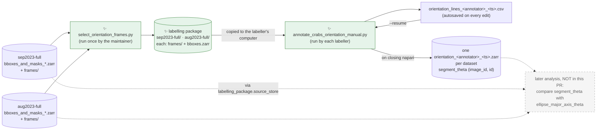
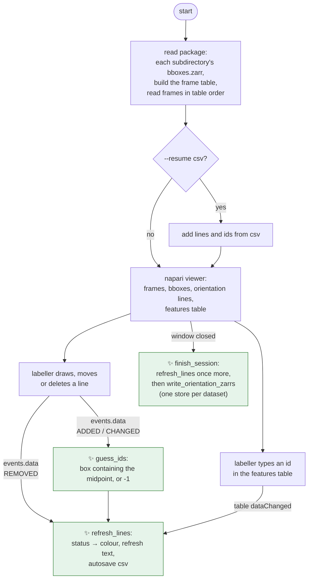

# Proposal for manual labelling of crab orientation in napari

## Description

Two `uv` scripts and a user guide that let a labeller draw one line per crab in napari.

- The first script picks a small set of frames. For each input store, it packs the frames and a
  slice of the store into one subdirectory of a labelling package.
- The second script opens both subdirectories in one napari session, and turns the lines drawn
  into an angle per box, `segment_theta`.
- The angles are saved as a slice of each input store plus one variable, on the same
  `(image_id, id)` grid, so they line up with `ellipse_major_axis_theta` with no lookup.



Solid arrows show data flowing between files and scripts in this PR. ✨ marks what is new in this
PR. The grey dashed node and dotted arrows are **not part of this PR**: they show the later
comparison with `ellipse_major_axis_theta`, which guides the output design (same `(image_id, id)`
grid and same angle convention as the input stores, and `source_store` recorded).

Links from the diagram:

- *sep2023-full / aug2023-full stores*: written by `main` in
  [generate_masks_from_bboxes.py:564](https://github.com/SainsburyWellcomeCentre/crabs-exploration/blob/main/scripts/generate_masks_from_bboxes.py#L564)
- *later analysis*: `ellipse_major_axis_theta` is computed in `compute_mask_props_dataset`,
  [generate_masks_from_bboxes.py:434](https://github.com/SainsburyWellcomeCentre/crabs-exploration/blob/main/scripts/generate_masks_from_bboxes.py#L434)

## References

- Draft workflow and open questions:
  [guides/ManualAnnotationOrientation.md](guides/ManualAnnotationOrientation.md) on
  `smg/orientation-labelling`. This PR rewrites that file as the user guide.
- PR [#298](https://github.com/SainsburyWellcomeCentre/crabs-exploration/pull/298)
  (merged into `main`): writes the input stores with
  [generate_masks_from_bboxes.py](https://github.com/SainsburyWellcomeCentre/crabs-exploration/blob/main/scripts/generate_masks_from_bboxes.py).
- ethology's annotations dataset, read from several COCO files as one dataset:
  [approximate subset sum split example](https://ethology.neuroinformatics.dev/latest/examples/approximate_subset_sum_split.html#read-as-a-single-annotation-dataset).
- How ethology numbers images:
  [ethology load_bboxes.py:497](https://github.com/neuroinformatics-unit/ethology/blob/v0.1.4/ethology/io/annotations/load_bboxes.py#L497)
  (checked in ethology 0.1.4).
- Pattern to reuse for autosave and resume:
  [annotate_burrow_prompts_manual.py:139](https://github.com/SainsburyWellcomeCentre/crabs-exploration/blob/main/scripts/burrows/annotate_burrow_prompts_manual.py#L139)
  (`_autosave_napari_points`).

## Overview of steps

Prerequisite: the input stores are generated after the fix in PR [#298](https://github.com/SainsburyWellcomeCentre/crabs-exploration/pull/298)

1. Move `scripts/generate_masks_from_bboxes.py` into a new `scripts/orientation/` folder, in its own
   commit: a pure `git mv`, plus the two places that refer to its path (the test's import and a
   notebook comment). The folder then holds the whole pipeline: masks and ellipses, then frame
   selection, then manual labelling ([Files changed](#files-changed)).
2. Add `scripts/orientation/select_orientation_frames.py`. It samples 2 frames per `Right` video of
   each input store, and writes one package subdirectory per store. A repeatable
   `--exclude-package` skips frames already used by earlier packages, for later labelling rounds.
3. Add `scripts/orientation/annotate_crabs_orientation_manual.py`. It opens both subdirectories in
   one napari session, links each line to a box, autosaves, resumes and writes one output zarr store
   per subdirectory.
4. Rewrite `guides/ManualAnnotationOrientation.md` as the step-by-step user guide, and add a minimal
   `scripts/orientation/README.md` that lists the three scripts in order and links to the guide.

## Key aspects of suggested implementation

### 1. The package holds one slice of each input store, in its own subdirectory

The labeller gets one folder of about 0.6 GB (rather than the full two stores plus 16 GB of frames).

- The input zarr stores do not hold the images.
- Each full `frames/` folder is about 7.9 GB, and each frame
  is about 15 MB.
- 38 selected frames are about 570 MB.
- The selection is fixed once and shared by every labeller.
- The labelling script stays small. It only reads the package, and never reads the COCO file or the
  input stores.

Directory structure of the labelling package:
```text
orientation_labelling_<timestamp>/
├── sep2023-full/
│   ├── frames/          # the 28 selected PNGs, copied unchanged
│   └── bboxes.zarr      # slice of the sep2023-full store
└── aug2023-full/
    ├── frames/          # the 10 selected PNGs, copied unchanged
    └── bboxes.zarr      # slice of the aug2023-full store
```

Each `bboxes.zarr` is a slice of its input store along `image_id`, keeping ethology's variables
and attributes only:

```python
pkg = ds.sel(image_id=selected)[["position", "shape", "category"]]
```

```text
bboxes.zarr                        # an ethology annotations dataset
├── image_id  (image_id,)          # the input store's values, e.g. [3, 17, 40, ...]
├── space     (space,)             # "x", "y"
├── id        (id,)                # the input store's values, 0..n_id - 1
├── position  (image_id, space, id)
├── shape     (image_id, space, id)
├── category  (image_id, id)
└── attrs: ethology's attributes only (annotation_files, annotation_format, images_directories,
           map_category_to_str, map_image_id_to_filename), with map_image_id_to_filename cut to
           the selected frames, plus:
           labelling_package: {source_store, seed, camera, frames_per_video, excluded_packages}
```

- `labelling_package` is a nested attribute: one attribute whose value is a dict, stored as JSON in
  the store's `zarr.json` and read as `pkg.attrs["labelling_package"]["seed"]`. It records how the
  package was built, so it can be reproduced:
  - `source_store`: full path of the input `bboxes_and_masks_*.zarr` that was sliced. Only the
    selection script writes it; the labelling script copies it unchanged. Its filename carries the
    SAM2 run's timestamp;
  - `seed`, `camera`, `frames_per_video`: the sampling settings;
  - `excluded_packages`: full paths of the earlier packages passed to `--exclude-package`, empty
    for a first round.
- The build time is not stored: it is already in the package folder name.

- Coordinates keep the input store's values. So `image_id` and `id` mean the same thing in the
  input store, the package and the output store, and nothing needs renumbering.
- `bboxes.zarr` holds bbox data only. Selecting the three variables drops `labels`, `label_of`,
  the mask and ellipse properties, and the `img_h`/`img_w` dims. It does not drop the root
  attributes, so these are whitelisted to ethology's: the SAM2 metadata (`sam2_model`,
  `mask_encoding`, `occlusion_policy`, ...) is left out. The selection script checks the package's
  variables and dims before writing it. Why:
  - the labeller does not need masks, and not showing the ellipses avoids biasing the labeller;
  - the input store stays the only copy of the masks and ellipses. Any later analysis can read them
    from there, through `labelling_package.source_store`.
- Filenames stay where ethology puts them, in the `map_image_id_to_filename` attribute. No
  `filename`, `video`, `dataset` or `source_image_id` coordinates are added.

The two datasets are kept in separate stores, as in the inputs, because both input stores start at
`image_id` 0. A single combined store would need `image_id` renumbered, and then:

- `image_id` would mean one thing in the package and another in the input stores;
- extra `dataset` and `source_image_id` coordinates would be needed to map back;
- `id` would be padded to the widest store.

Rejected alternatives:

| Option | Why worse |
|---|---|
| Sample with a seed inside the labelling script | Every labeller must download both stores and all 1094 frames. |
| Precompute a CSV of selected frames | Same download problem. The labelling script would also need the input stores. |
| One combined store, with `image_id` renumbered 0..N-1 | Two meanings of `image_id`, extra `dataset` and `source_image_id` coordinates, padded `id`, and a lookup at comparison time. |
| Rebuild the boxes from the COCO file with ethology | The selection script would need ethology and the COCO file, for the same boxes the store already holds. Matching `ellipse_major_axis_theta` by `id` would also rely on both sides using ethology ≥ 0.1.4 ([§2](#2-the-input-stores-are-ethology-annotations-datasets-with-masks)). |
| ✅ One slice per input store, each in its own subdirectory | Chosen. |

### 2. The input stores are ethology annotations datasets with masks

`generate_masks_from_bboxes.py` builds each store from `load_bboxes.from_files(...)`, then adds
`labels`, `label_of` and the mask properties on the same grid. So each store already is an ethology
annotations dataset, expanded with masks:

- dims `image_id`, `space`, `id`, and variables `position`, `shape`, `category`, as ethology's
  `ValidBboxAnnotationsDataset` requires;
- every variable, `labels` included, is indexed by `image_id`. No variable uses `time`;
- `image_id` is the position of the image in the sorted list of COCO filenames
  ([load_bboxes.py:497](https://github.com/neuroinformatics-unit/ethology/blob/v0.1.4/ethology/io/annotations/load_bboxes.py#L497));
- root attributes, as ethology sets them: `annotation_files`, `annotation_format`,
  `images_directories`, `map_category_to_str`, `map_image_id_to_filename`. The script adds its
  own metadata, for example `timestamp` and `sam2_model`.

The selection script reads filenames from `map_image_id_to_filename`. It stops with an error if
the attribute is missing, asking for the store to be written again with
`generate_masks_from_bboxes.py` on `main`. Stores written before PR #298 have empty root
attributes.

**`id` follows the order of the annotations in the COCO file.** `id` is the box's position within
its image after ethology sorts the boxes. Since ethology 0.1.4, every sort is stable
([ethology PR #164](https://github.com/neuroinformatics-unit/ethology/pull/164);
[load_bboxes.py:604](https://github.com/neuroinformatics-unit/ethology/blob/v0.1.4/ethology/io/annotations/load_bboxes.py#L604)),
so `id` no longer depends on the environment. `generate_masks_from_bboxes.py` on `main` pins
`ethology>=0.1.4`.

Checked on the current local stores (`…_20261026_*`): `position`, `shape` and `category` are
identical, in the same order, to a fresh `load_bboxes.from_files` with ethology 0.1.4, in both
`sep2023-full` and `aug2023-full`.

> [!NOTE]
> Stores written with ethology 0.1.3 or earlier may hold boxes in a different order along `id`:
> those versions sorted with pandas' default, unstable `sort_values`. Rewrite such stores with
> `main` before building a package.

### 3. A line is linked to the box that contains its midpoint

A line belongs to the box whose rectangle contains the line's midpoint.

- This is a point-in-rectangle test: four comparisons per box, with no geometry library.
- It matches what a labeller does: they draw the line over the crab, so its middle lands on the
  crab.
- Neighbouring boxes often overlap. A long line can cross two boxes even when the intended crab is
  obvious, but its midpoint usually lies in one box only.

`position` is the box centre in ethology, so a box spans `position ± shape / 2`.

Each line has one feature, `id`.

- `id` matches the name of the `id` coordinate in the input stores. In ethology, `id` is the box's
  slot within a frame, not an identity tracked across frames, so the draft's word "individual" is
  not used.
- `-1` means "not linked".

Each line gets one of three statuses. The status sets its colour:

| Status | Colour | Rule | Saved to the zarr store? |
|---|---|---|---|
| `linked` | green | `id` is a box whose rectangle contains the midpoint, and no other line on the frame has the same `id` | yes |
| `ambiguous` | yellow | the midpoint is inside 2 or more boxes and `id` is `-1`; or another line on the frame has the same `id` | no |
| `unlinked` | red | the midpoint is inside no box; or `id` is a box that does not contain the midpoint | no |

`id` is guessed automatically when a line is drawn or moved:

- midpoint inside exactly 1 box: `id` is that box;
- otherwise: `id` is `-1`, and napari shows a warning.

The labeller fixes a yellow line by typing the right `id` in the features table.
The labeller fixes a red line by moving it into a box. The guess runs again after the move.

### 4. Two save files: a CSV during labelling, zarr stores at the end

Each file has one job:

- **`orientation_lines_<annotator>_<ts>.csv`** is the working file. It is autosaved on every edit,
  holds every line in every status from both datasets, and is what `--resume` reads.
- **`<dataset>/orientation_<annotator>_<ts>.zarr`** is the result, one per dataset with at least
  one green line. It is written when the napari window closes, holds green lines only, and is
  rebuilt from the CSV every time.

`--resume` continues the same session rather than starting a new one: it reuses the CSV's
`<ts>`, autosaves into the same CSV, and overwrites the zarr stores on close. So each annotator
ends up with one CSV and at most one zarr store per dataset, however many times they resume.
Overwriting the zarr stores is safe because they are derived from the CSV: if a write fails,
resuming and closing again rebuilds them.

Both names carry the annotator, so the `labels/` folders sent back by several labellers can be
gathered in one place without clashes. The annotator is also saved in the output attributes
([§5](#5-each-output-store-is-the-package-slice-plus-segment_theta)).

The CSV autosave reuses the pattern of `_autosave_napari_points`
([annotate_burrow_prompts_manual.py:139](https://github.com/SainsburyWellcomeCentre/crabs-exploration/blob/main/scripts/burrows/annotate_burrow_prompts_manual.py#L139)):
write to a `.tmp` file, then `os.replace`.

- `os.replace` swaps a file atomically on Windows too. It cannot replace a non-empty directory on
  Windows, so a zarr store cannot be autosaved safely the same way.
- A crash loses nothing. Run again with `--resume <csv>`, then close the window to write the zarr
  stores.
- On `--resume`, the CSV is first copied once to `<csv>.bak`, so a bad resumed session (for
  example, lines deleted by mistake) can be undone.

CSV columns, one row per line:

```text
dataset, image_id, id, x0, y0, x1, y1, segment_theta, status
```

- Rows are keyed by `(dataset, image_id)`, not by napari frame index, so a CSV still reads
  correctly if the frame order ever changes.
- The `status` column is the log of red and yellow lines asked for in the draft. A separate log
  file would repeat these rows. See [Points to discuss #2](#points-to-discuss).

### 5. Each output store is the package slice plus `segment_theta`

```python
out = pkg.assign(segment_theta=(("image_id", "id"), theta))
```

```text
<dataset>/orientation_<annotator>_<ts>.zarr
├── image_id, space, id, position, shape, category    (from the package's bboxes.zarr)
├── segment_theta  (image_id, id) float64, NaN where no green line
└── attrs: the package's attributes (ethology's, labelling_package), plus
           labelling_session: {annotator, package_dir, lines_csv, napari_version}
```

- It is still an ethology annotations dataset, with the same coordinates as the input store. So
  comparing with the input store is a plain `.sel(image_id=out.image_id)`.
- `labelling_session` is a nested attribute, like `labelling_package`, written by the labelling
  script. `package_dir` and `lines_csv` are full paths on the labeller's computer, kept for
  reference only. The session's timestamp is not stored: it is already in the output and CSV
  filenames.

`segment_theta` uses the same convention as `ellipse_major_axis_theta`
([generate_masks_from_bboxes.py:434](https://github.com/SainsburyWellcomeCentre/crabs-exploration/blob/main/scripts/generate_masks_from_bboxes.py#L434)):

- it is measured from the image x-axis towards the y-axis, in radians, in [0, π);
- the image y-axis points down, so a positive angle looks clockwise on screen.

```python
theta = np.mod(np.arctan2(y1 - y0, x1 - x0), np.pi)
```

The store is indexed by `image_id`, as the input stores and ethology are. Annotated frames are
independent images, not a time series.

### 6. napari setup

The napari behaviour below was verified against the napari 0.7.0a3 source in the repo's `.venv`.

napari shows both datasets as one stack of frames.

- **Frame table.** A small `frames` table has one row per napari frame, with columns `dataset`,
  `image_id` and `filename`. It is built from each package's `image_id` and
  `map_image_id_to_filename`. The napari frame index is a row of this table.
- **Frames.** The image stack is built from the table, one lazy `imread` per row, in row order:
  `da.concatenate([imread(sub / "frames" / filename) for each row])`. So frame `i` shows the file
  named in row `i` by construction, and the order never relies on sorting files on disk. All
  frames in both datasets are 4096 × 2160, so they stack.

The frame table is needed for two reasons:

- a napari stack is indexed 0..N-1 with no gaps, while each slice keeps its input store's sparse
  `image_id` values, e.g. `[63, 89, 149, ...]`. For one dataset, this alone would only need the
  array `pkg.image_id.values`;
- `image_id` is unique within a store, but not across the two: both start at 0. So a frame is
  identified by `(dataset, image_id)`.

So napari and the data name the same frame differently: napari by its position in the stack (0 to
37), the data by `(dataset, image_id)`. For example:

| napari frame | dataset | image_id | filename |
|---|---|---|---|
| 0 | aug2023-full | 12 | `…_frame_000120.png` |
| … | … | … | … |
| 10 | sep2023-full | 63 | … |

The script never uses napari's frame index as an `image_id`. It converts through the table at the
three points where napari and the data meet:

- **showing boxes** (data → napari): the boxes of `("sep2023-full", 63)` are drawn on frame 10;
- **linking a line** (napari → data): a line drawn on frame 10 is checked against the boxes of
  `("sep2023-full", 63)`;
- **saving** (napari → data): that line's CSV row and its `segment_theta` are stored under
  `("sep2023-full", 63)`, not under frame 10.

| Layer | Setup |
|---|---|
| `frames` | the concatenated lazy stack above, so 38 × 26 MB is not loaded at once |
| `bboxes` | rectangles, features `{"id": ...}`, `text="{id}"`, `editable = False` |
| `orientation lines` | `shape_type="line"`, mode `add_line`, features `{"id": int}`, `feature_defaults={"id": -1}`, `text="{id}"` |

The features table opens on start-up, with editing switched on:

```python
dock, table = viewer.window.add_plugin_dock_widget("napari", "Features table widget")
table.toggle.setChecked(True)  # the "editable" switch
```

Two napari facts drive the event wiring:

- Drawing a line emits a single `events.data` with `action=ADDED` on mouse release, after the end
  point is set (`Shapes._finish_drawing`). Moving a shape emits `CHANGED`, and deleting emits
  `REMOVED`.
- Typing an `id` in the features table updates `layer.features`, but **the layer does not
  announce it**: no layer event is emitted. Listening only to the layer, the script would miss
  typed ids, so a fixed yellow line would stay yellow and the CSV would not update. So the script
  also listens to the table widget's own Qt signal, `dataChanged`, which fires when a cell is
  edited. That signal is internal to napari's widget, not public API, so a future napari release
  could change it and silently break this. Hence the version pin in
  [Points to discuss #7](#points-to-discuss).

## Detailed implementation



Arrows are the order things happen in the labelling script. Edge labels name the event that
triggers the next step. Everything from *start* to the *napari viewer* is `build_session`; the last
node is `finish_session`; `napari.run()` sits between them, only in `main()`.

Links from the diagram:

- *refresh_lines* reuses the autosave pattern of `_autosave_napari_points`,
  [annotate_burrow_prompts_manual.py:139](https://github.com/SainsburyWellcomeCentre/crabs-exploration/blob/main/scripts/burrows/annotate_burrow_prompts_manual.py#L139)

| # | Change | Signature |
|---|---|---|
| 1 | Read a store and check it has ethology's attributes | `load_store(store_path: Path) -> xr.Dataset` |
| 2 | Keep one camera, drop frames used by earlier packages, and sample frames per video | `excluded_image_ids(exclude_packages: list[Path], ds: xr.Dataset, dataset: str) -> set[int]`, `select_frames(ds: xr.Dataset, camera: str, frames_per_video: int, seed: int, exclude: set[int] = frozenset()) -> np.ndarray` (selected `image_id`s) |
| 3 | Slice the store, copy its frames, write one subdirectory | `write_package_subdir(ds: xr.Dataset, image_ids: np.ndarray, store_path: Path, output_dir: Path) -> Path` |
| 4 | Read the package and build the frame table | `load_package(package_dir: Path) -> tuple[dict[str, xr.Dataset], pd.DataFrame, da.Array]` |
| 5 | Box rectangles for napari, one `id` per rectangle | `bboxes_to_napari_shapes(packages: dict[str, xr.Dataset], frames: pd.DataFrame) -> tuple[list[np.ndarray], np.ndarray]` |
| 6 | Ids of the boxes containing a point | `boxes_containing(pkg: xr.Dataset, image_id: int, x: float, y: float) -> np.ndarray` |
| 7 | Guess `id` for drawn or moved lines | `guess_ids(layer: Shapes, indices: list[int], packages, frames) -> None` |
| 8 | Status of every line | `line_status(layer: Shapes, packages, frames) -> np.ndarray` |
| 9 | Recolour, refresh text, autosave | `refresh_lines(layer: Shapes, packages, frames, autosave_csv: Path) -> None` |
| 10 | Lines ↔ CSV rows | `lines_to_dataframe(layer, status, frames) -> pd.DataFrame`, `dataframe_to_lines(df, frames) -> tuple[list[np.ndarray], np.ndarray]` |
| 11 | Write the results | `write_orientation_zarrs(df: pd.DataFrame, packages: dict[str, xr.Dataset], labels_dir: Path) -> list[Path]` |
| 12 | Set up a session: load the package, add layers, resume lines, open the table, connect handlers. No event loop | `build_session(package_dir: Path, annotator: str, resume_csv: Path \| None = None, viewer: napari.Viewer \| None = None) -> Session` |
| 13 | End a session: final refresh and autosave, then write the results | `finish_session(session: Session) -> list[Path]` |
| 14 | User guide | rewrite `guides/ManualAnnotationOrientation.md` |

<details><summary><b>Steps 1–3: select_orientation_frames.py</b></summary>

Command line:

```text
uv run select_orientation_frames.py STORE [STORE ...]
    [--output-dir .] [--camera Right] [--frames-per-video 2] [--seed 42]
    [--exclude-package PACKAGE_DIR ...]
```

- `--exclude-package` is repeatable. It names earlier labelling packages whose frames must not be
  picked again, so a second or third round labels new frames only.

- `STORE` is a `bboxes_and_masks_*.zarr` path. Its data directory is `STORE.parent.parent`, which
  holds `frames/`. This is the layout `generate_masks_from_bboxes.py` already expects. The
  subdirectory is named after the data directory, e.g. `sep2023-full`.
- Dependencies: `numpy`, `pandas`, `xarray`, `zarr`, `dask`. No ethology: the store already is an
  ethology dataset, and nothing is loaded from COCO.

```python
BBOX_VARS = ["position", "shape", "category"]
BBOX_DIMS = {"image_id", "space", "id"}
ETHOLOGY_ATTRS = ["annotation_files", "annotation_format", "images_directories",
                  "map_category_to_str", "map_image_id_to_filename"]

package_dir = output_dir / f"orientation_labelling_{timestamp}"
FOR EACH store_path IN args.stores:
    ds = xr.open_zarr(store_path)
    CHECK "map_image_id_to_filename" in ds.attrs     # else: rewrite the store with main
    filenames = {int(k): v for k, v in ds.attrs["map_image_id_to_filename"].items()}
    exclude = excluded_image_ids(args.exclude_package, ds, data_dir.name)
    table = DataFrame(image_id, filename, video=filename.split("_frame")[0])
    keep rows whose video contains f"-{camera}", and drop rows whose image_id is in exclude
    selected = sorted image_ids of, per video, sample(min(frames_per_video, frames left),
                                                      random_state=seed)
    print each video that had fewer than frames_per_video frames left (0 left: skipped)

    pkg = ds.sel(image_id=selected)[BBOX_VARS]
    pkg.attrs = {
        **{k: ds.attrs[k] for k in ETHOLOGY_ATTRS},   # no SAM2 / mask metadata
        "map_image_id_to_filename": {i: filenames[i] for i in selected},
        "labelling_package": {"source_store": str(store_path.resolve()),
                              seed, camera, frames_per_video,
                              "excluded_packages": [str(p.resolve()) for p in exclude_package]},
    }
    CHECK set(pkg.data_vars) == set(BBOX_VARS) and set(pkg.dims) == BBOX_DIMS
    subdir = package_dir / data_dir.name
    copy each selected PNG into subdir / "frames"
    cast `space` to object, write subdir / "bboxes.zarr"
```

Expected result on the two local stores:

- 14 Right videos in `sep2023-full`, so 28 frames;
- 5 Right videos in `aug2023-full`, so 10 frames;
- 38 frames in total. Every Right video has at least 5 annotated frames, so sampling 2 never runs
  short.

`excluded_image_ids`:

```python
excluded = set()
FOR EACH old IN exclude_packages:
    store = old / dataset / "bboxes.zarr"
    IF not store.exists(): CONTINUE                # that package had no frames of this dataset
    old_pkg = xr.open_zarr(store)
    CHECK old_pkg.attrs["annotation_files"] == ds.attrs["annotation_files"]
        # else stop: built from another COCO file, so its image_ids may name other frames
    excluded |= set(old_pkg.image_id.values)
RETURN excluded
```

- Comparing `annotation_files` is enough: `image_id` comes from the sorted COCO filenames, so the
  same COCO file gives the same `image_id`s, whichever SAM2 run wrote the store.
- With `--frames-per-video 2`, a second round still gets 2 frames from every Right video (each has
  at least 5, so at least 3 are left). A third round runs short on 5-frame videos, which then give
  1 frame each, and are reported.
- Different rounds' output stores share the input store's full `id` dimension, so they can be
  joined along `image_id` for analysis.

</details>

<details><summary><b>Steps 4–13: annotate_crabs_orientation_manual.py</b></summary>

Command line:

```text
uv run annotate_crabs_orientation_manual.py PACKAGE_DIR --annotator NAME [--resume CSV]
```

- `--annotator` is required, so every output says who drew it. `NAME` must match
  `[A-Za-z0-9-]+`, so it can be split back out of filenames (no `_`, no spaces).
- `--resume` stops with an error if the CSV's name does not start with
  `orientation_lines_<NAME>_`, so one labeller cannot continue another's work by mistake.
- Outputs go to `PACKAGE_DIR/labels/`, next to the frames, so a labeller on Windows finds them
  without searching.
- A new session gets a new timestamp. `--resume` reuses the timestamp in the CSV's name, keeps
  autosaving into that CSV (after copying it once to `<csv>.bak`), and overwrites that session's
  zarr stores on close. This differs from the burrow script, which writes a new CSV per session,
  so that outputs do not pile up across resumes.
- Dependencies: `napari[pyqt5]` (pinned, see [Points to discuss #7](#points-to-discuss)), `numpy`,
  `pandas`, `xarray`, `zarr`, `dask`, `Pillow`.
- The `uv` header also has a `[tool.uv]` table, so every labeller runs the same environment:

    ```python
    # [tool.uv]
    # required-version = ">=<uv-version>"           # lowest uv tested; uv stops with an error
    #                                               # asking to `uv self update` if older
    # exclude-newer = "<date the script was tested>" # resolve all dependencies as of this date
    ```

  Both settings were checked with uv 0.13.0: `required-version` is enforced from a script header,
  and `exclude-newer` is accepted there.
- **Labellers run the script from a raw GitHub URL pinned to a tag**, never `main`
  ([Step 14](#detailed-implementation), [Points to discuss #10](#points-to-discuss)). Before sending
  the guide out, the maintainer creates the tag (e.g. `orientation-labelling-v1`) on the merged
  commit, and the guide's command uses it. A fix during labelling gets a new tag, and the guide is
  updated to it.

`load_package`:

```python
packages = {sub.name: xr.open_zarr(sub / "bboxes.zarr").load() for sub in sorted subdirs}
frames = DataFrame of (dataset, image_id, filename), datasets in sorted order,
         image_id ascending within each, filename from map_image_id_to_filename
CHECK every package_dir / dataset / "frames" / filename exists
images = da.concatenate([imread(package_dir / dataset / "frames" / filename)
                         for dataset, filename in frames rows])
```

The start-up check stops the script with an error if a frame is missing. A frame cannot show the
wrong boxes, because each one is read by the name its `(dataset, image_id)` gives.

**Setup is split from the event loop**, so tests can drive a session without `napari.run()`
blocking ([GUI tests](#gui-tests)). `main()` only parses arguments and chains three calls:

```python
def main(args):
    import napari                                      # not at module level, see Tests
    session = build_session(args.package_dir, args.annotator, args.resume)
    napari.run()                                       # blocks until the window is closed
    finish_session(session)
```

`Session` is a small dataclass holding what the handlers and `finish_session` share:

```python
@dataclass
class Session:
    viewer: napari.Viewer
    lines: Shapes                     # the "orientation lines" layer
    bboxes: Shapes
    table: QWidget                    # the features table widget
    packages: dict[str, xr.Dataset]
    frames: pd.DataFrame              # the frame table
    box_ids: np.ndarray               # original bboxes "id" feature, to undo table edits
    annotator: str
    timestamp: str                    # new, or reused from the resumed CSV's name
    autosave_csv: Path
    labels_dir: Path
```

`build_session` does everything up to, but not including, the event loop:

```python
def build_session(package_dir, annotator, resume_csv=None, viewer=None) -> Session:
    packages, frames, images = load_package(package_dir)
    IF resume_csv: check annotator matches its name, copy it once to <csv>.bak, reuse its timestamp
    viewer = viewer or napari.Viewer()           # tests pass make_napari_viewer()
    add frames, bboxes and orientation lines layers (§6); lines layer selected
    IF resume_csv: add lines and ids from dataframe_to_lines(pd.read_csv(resume_csv), frames)
    open the features table, switch "editable" on
    session = Session(...)

    def on_lines_data(event):
        IF event.action == ADDED:
            guess_ids(session.lines, [len(session.lines.data) - 1], packages, frames)
        ELIF event.action == CHANGED:
            guess_ids(session.lines, list(event.data_indices), packages, frames)
        ELIF event.action != REMOVED:
            return                                       # skip ADDING / CHANGING / REMOVING
        refresh_lines(session.lines, packages, frames, session.autosave_csv)

    def on_table_edit(*_):
        IF not np.array_equal(session.bboxes.features["id"], session.box_ids):
            session.bboxes.features = {"id": session.box_ids}  # undo; setter emits
            session.bboxes.refresh_text()                      # events.features, table redraws
        refresh_lines(session.lines, packages, frames, session.autosave_csv)

    session.lines.events.data.connect(on_lines_data)
    session.table.table.model().sourceModel().dataChanged.connect(on_table_edit)
    refresh_lines(...)                           # colour resumed lines, write the first autosave
    RETURN session

def finish_session(session) -> list[Path]:
    refresh_lines(session.lines, session.packages, session.frames, session.autosave_csv)
    RETURN write_orientation_zarrs(pd.read_csv(session.autosave_csv), session.packages,
                                   session.labels_dir)
```

- The table's `dataChanged` handler is connected after the widget's own write-back handler. Qt
  calls them in connection order, so `layer.features` is already updated when `refresh_lines` runs.
- `refresh_lines` sets `layer.edge_color` from the statuses, calls `layer.refresh_text()`, and
  autosaves the CSV.
- `guess_ids` shows a napari warning for each new red or yellow line.
- Moving a line runs the guess again, so a hand-typed `id` is replaced. This keeps one rule ("the
  line's position decides"). The user guide says so.

`write_orientation_zarrs`:

```python
FOR EACH dataset, pkg IN packages.items():
    rows = green rows of df with df.dataset == dataset
    store = labels_dir / dataset / f"orientation_{annotator}_{timestamp}.zarr"
    IF rows is empty:
        remove store if it exists          # stale from an earlier session of this resume chain
        CONTINUE
    theta = np.full((pkg.sizes["image_id"], pkg.sizes["id"]), np.nan)
    theta[pkg.indexes["image_id"].get_indexer(rows.image_id),
          pkg.indexes["id"].get_indexer(rows.id)] = rows.segment_theta
    out = pkg.assign(segment_theta=(("image_id", "id"), theta))
    out.attrs["labelling_session"] = {annotator, package_dir, lines_csv, napari_version}
    out.to_zarr(store, mode="w")           # overwrite on resume
```

Rejected alternatives:

| Option | Why worse |
|---|---|
| Two labelling sessions, one per subdirectory | The labeller runs the script twice. One session costs only the frame table, which a slice needs anyway. |
| Autosave straight into the zarr stores | A directory cannot be swapped atomically on Windows, so a crash mid-write could corrupt a store. |
| Re-check statuses on a timer instead of on events | Recolours shapes while the labeller is still dragging. |
| Load all frames into memory, as the burrow script does | About 1 GB of RAM for 38 frames of 4096 × 2160 × 3. |

</details>

<details><summary><b>Step 14: user guide</b></summary>

`guides/ManualAnnotationOrientation.md` is rewritten for a labeller on Windows who may not have
Python. Its sections:

1. **Install uv** with Astral's standard installer:
   `powershell -ExecutionPolicy ByPass -c "irm https://astral.sh/uv/install.ps1 | iex"`.
   `uv` downloads a suitable Python by itself, so no Python install is needed. No particular uv
   version is needed: the script declares its minimum, and if uv is too old it stops with a
   message saying to run `uv self update`.
2. **Copy the labelling package from ceph.** One folder, about 0.6 GB.
3. **Run the script straight from GitHub**, with no download step, using the exact command given in
   the guide:
   `uv run https://raw.githubusercontent.com/SainsburyWellcomeCentre/crabs-exploration/<tag>/scripts/orientation/annotate_crabs_orientation_manual.py <package> --annotator <name>`,
   with the same name in every session. **The URL is pinned to a tag, never `main`**, so every
   labeller, and every session, runs the same code even if `main` changes during labelling.
5. **Label.** Draw one line per box, parallel to the crab's long axis. Colours, the features table,
   and how to fix yellow and red lines. Shortcuts for hiding the boxes (`V`, `Shift + V`).
6. **Your files.** A short explanation, in plain words, of what appears in `labels/`
   ([§4](#4-two-save-files-a-csv-during-labelling-zarr-stores-at-the-end)):
   - `orientation_lines_<name>_<ts>.csv`: your work in progress. It is saved after every change and
     holds all your lines, including red and yellow ones. This is the file you pass to `--resume`.
   - `orientation_lines_<name>_<ts>.csv.bak`: a copy of the CSV from before your last resume, in
     case lines were deleted by mistake.
   - `sep2023-full/orientation_<name>_<ts>.zarr` and `aug2023-full/…`: the results, green lines
     only. They are written when you close the window, and rebuilt from the CSV each time. If one
     is missing or looks wrong, resume and close again.
   - Do not edit, rename or move these files.
   - You never need napari's **File > Save** (Ctrl+S): your work is saved automatically. That menu
     exports layers in napari's own format to a place you choose, and is not what we need back.
7. **Stop and resume.** Close the window to finish. To continue later, or after a crash, run again
   with `--resume <csv>`: the same files are updated, no new ones are made.
8. **Send back** the whole `labels/` folder, CSV included. The CSV keeps the red and yellow lines,
   which the zarr stores do not.
9. **For the maintainer:** how to run `select_orientation_frames.py` on ceph, on stores written
   with `main` after PR #298; how to build a later round's package with
   `--exclude-package <each earlier package>`; and how to create the tag that the labellers'
   command points to before sending the guide out.

</details>

## Files changed

| File | Change |
|---|---|
| `scripts/generate_masks_from_bboxes.py` → `scripts/orientation/generate_masks_from_bboxes.py` | **moved** with `git mv`, unchanged, in its own commit |
| `tests/test_unit/test_generate_masks_from_bboxes.py` | import updated to `scripts.orientation.generate_masks_from_bboxes` |
| `notebooks/notebook_visualise_masks_from_zarr.py` | path in a comment updated |
| `scripts/orientation/select_orientation_frames.py` | **new**, about 120 lines |
| `scripts/orientation/annotate_crabs_orientation_manual.py` | **new**, about 320 lines |
| `scripts/orientation/README.md` | **new**, minimal (below) |
| `guides/ManualAnnotationOrientation.md` | rewritten from the draft into the user guide |
| `tests/test_unit/test_scripts_orientation.py` | **new**, 4 unit tests ([Unit tests](#unit-tests)) |
| `tests/test_gui/__init__.py`, `tests/test_gui/test_annotate_orientation_gui.py` | **new**, 5 GUI tests, run in their own CI job ([GUI tests](#gui-tests)) |
| `pyproject.toml` | register the `gui` marker next to `slow` |
| `.github/workflows/test_and_deploy.yml` | **new job** `test_gui`, next to `test_sam2` ([GUI tests](#gui-tests)) |

The three scripts form one pipeline, so they go in one folder, `scripts/orientation/`, as
`scripts/burrows/` does for the burrow pipeline. The draft's script URL changes to match. The move
of `generate_masks_from_bboxes.py` touches only two references on `main` (checked with
`git grep`), and no guide links to its raw URL. Anyone running it on ceph by its old path needs the
new one; the PR description says so.

The README is short, because the guide already explains how to label. It is for someone browsing
`scripts/`, and only gives the order and where to read more:

```markdown
## Crab orientation: ellipses from masks, and manual labels to check them

1. `generate_masks_from_bboxes.py`: SAM2 masks and ellipse parameters from annotated boxes.
2. `select_orientation_frames.py`: build a labelling package from its output stores.
3. `annotate_crabs_orientation_manual.py`: label crab orientation in napari.

Steps 2 and 3: see [guides/ManualAnnotationOrientation.md](../../guides/ManualAnnotationOrientation.md).
```

## Tests

### Unit tests

Four unit tests in `tests/test_unit/test_scripts_orientation.py`, on small synthetic datasets
built in fixtures, as in `test_scripts_burrows.py` and `test_generate_masks_from_bboxes.py`. They
cover the logic that could silently corrupt results, and need no display or napari:

1. **Package slicing** (`select_frames`, `write_package_subdir`): from a synthetic store with mask
   variables and SAM2 attributes, check that only the chosen camera is kept, that each video gives
   `frames_per_video` frames, that the same seed gives the same selection, and that `bboxes.zarr`
   holds only `position`, `shape`, `category`, ethology's attributes and `labelling_package`
   ([§1](#1-the-package-holds-one-slice-of-each-input-store-in-its-own-subdirectory)).
2. **Linking and angle** (`boxes_containing`, `segment_theta`): a midpoint inside one box, inside
   two overlapping boxes, and inside none gives 1, 2 and 0 ids. A horizontal line gives θ = 0, a
   line drawn down-right gives π/4, and reversing a line's direction gives the same θ
   ([§3](#3-a-line-is-linked-to-the-box-that-contains-its-midpoint),
   [§5](#5-each-output-store-is-the-package-slice-plus-segment_theta)).
3. **Writing results** (`write_orientation_zarrs`): with sparse `image_id`s (e.g. `[5, 7]`, so a
   position-for-`image_id` mix-up fails), check that green rows land at the right
   `(image_id, id)`, that other cells are NaN, that yellow and red rows are not written, and that a
   dataset with no green rows has its store removed
   ([§5](#5-each-output-store-is-the-package-slice-plus-segment_theta)).
4. **Excluding earlier packages** (`excluded_image_ids`, `select_frames`): build a package, then a
   second one excluding it, and check the two share no `image_id`; with a video that has fewer
   frames left than `frames_per_video`, check it gives what is left, and a video with none left
   gives none; exclude two packages at once; and check an old package with different
   `annotation_files` raises an error ([Steps 1–3](#detailed-implementation)).

To make this possible, the labelling script imports napari inside `main()`, not at module level,
since napari is not a `dev` dependency. The angle formula goes in a small helper,
`segment_theta(x0, y0, x1, y1) -> float`, used by `lines_to_dataframe`.

### GUI tests

Five tests in `tests/test_gui/test_annotate_orientation_gui.py` drive a real napari session, so the
napari wiring (events, colours, features table, resume, results) is checked by code rather than by
hand. They rely on the split between `build_session` and `finish_session`
([Steps 4–13](#detailed-implementation)): each test builds a session on a viewer from napari's
`make_napari_viewer` fixture, acts on it as a labeller would, and calls `finish_session` instead
of closing a window.

Fixture: a tiny synthetic package in `tmp_path`, with two datasets of two frames each (small PNGs,
e.g. 96 × 64), sparse `image_id`s (e.g. `[5, 7]` and `[0, 3]`), and boxes placed so that some
overlap.

| # | Test | Replaces manual step | How it acts | What it checks |
|---|---|---|---|---|
| 1 | Boxes on the right frames | 3 | builds a session | every rectangle on napari frame `i` equals `position ± shape / 2` of the `(dataset, image_id)` in row `i` of the frame table; one `viewer.screenshot()` per dataset is saved to `tmp_path` for a visual check |
| 2 | Line statuses | 4 | `session.lines.add_lines(...)`: one line inside one box, one inside two overlapping boxes, one outside every box | edge colours are green, yellow, red; the CSV's `status` column matches; guessed `id`s are the box, `-1`, `-1` |
| 3 | Table edits | 5 | `model.setData(index, value)` on the table, the same path as typing: the yellow line's `id`, then a box's `id` | the yellow line turns green and the CSV updates; the box `id` reverts at once |
| 4 | Resume | 6 | builds a session, adds lines, drops it without `finish_session` (as after a crash), then builds again with `resume_csv` | the same lines come back on the same `(dataset, image_id)` with the same `id`s; autosaves go to the same CSV; `<csv>.bak` exists; resuming with another annotator raises an error |
| 5 | Results on close | 7 | `finish_session`, then resume, add a line and `finish_session` again; then delete all green lines of one dataset and finish | `segment_theta` has one value per green line; the second finish overwrites the same store paths; the emptied dataset's store is removed |

How they run follows the repo's pattern for SAM2: skipped in the main `test` job, run in a
dedicated job that installs what they need and fails, rather than skips, if that install broke.

- **Main `test` job: skipped.** The tests are marked `@pytest.mark.gui` and start with
  `pytest.importorskip("napari")` and `pytest.importorskip("pytestqt")`. napari and `pytest-qt`
  are not `dev` dependencies, so the main job, which also runs on macOS, skips them.
- **New `test_gui` job: run.** On `ubuntu-latest`, with a virtual display:

    ```yaml
    test_gui:
      name: Run napari GUI tests
      needs: [linting, manifest]
      runs-on: ubuntu-latest
      steps:
        - uses: actions/checkout@v7
        - uses: astral-sh/setup-uv@v7
          with:
            python-version: "3.13"
            activate-environment: true
        # Qt, OpenGL and a virtual X display for napari
        - name: Install display libraries
          run: |
            sudo apt-get update
            sudo apt-get install -y xvfb libegl1 libgl1 libopengl0 libdbus-1-3 \
              libxkbcommon-x11-0 libxcb-cursor0 libxcb-icccm4 libxcb-image0 \
              libxcb-keysyms1 libxcb-randr0 libxcb-render-util0 libxcb-shape0 \
              libxcb-xfixes0 libxcb-xinerama0
        # same napari version as pinned in the labelling script's uv header
        - name: Install crabs, napari and pytest-qt
          run: uv pip install -e ".[dev]" "napari[pyqt5]==<pin>" pytest-qt
        - name: Run GUI tests
          run: |
            # fail here, rather than skip the tests, if napari did not install
            python -c "import napari, pytestqt"
            xvfb-run -a pytest -m gui tests/test_gui
    ```

  The napari version is pinned twice, in the script's `uv` header and here. A comment next to each
  pin says to change both together ([Points to discuss #7](#points-to-discuss)).
- **Locally**, where a display is available:

    ```text
    uv run --with "napari[pyqt5]==<pin>" --with pytest-qt pytest -m gui tests/test_gui
    ```

  Not in an agent's sandbox on macOS (checked): Qt's `offscreen` platform has no OpenGL there, so
  napari's canvas crashes, and the normal platform needs the macOS window server, which the
  sandbox blocks. CI is where they run routinely.

What they do not cover: drawing with a real mouse (lines are added in code, which emits the same
`events.data` ADDED event but skips napari's mouse-drawing path), and anything specific to
Windows. A short hand check covers these ([Verifications](#verifications-for-agent-to-run), step 3).

## Documentation updates

Yes: `guides/ManualAnnotationOrientation.md` is rewritten.

It also fixes two problems in the draft's ceph paths:

- the timestamps are out of date: the stores were rewritten after PR #298. Locally,
  `sep2023-full` is now `…_20261026_123937` and `aug2023-full` is `…_20261026_125630` (to check
  against ceph);
- the paths are missing the `annotations/` folder.

## Gotchas

| Detail | Consequence | Handling |
|---|---|---|
| Stores written before PR #298's fix have no root attributes | No `map_image_id_to_filename` | The selection script stops with an error asking for the store to be written again with `main` |
| Stores written with ethology ≤ 0.1.3 may order boxes differently along `id` | `id` would not match a fresh ethology load | Use stores written with `main` (ethology ≥ 0.1.4); the scripts only slice the input store anyway ([§2](#2-the-input-stores-are-ethology-annotations-datasets-with-masks)), and stores are always consistent with themselves. |
| napari frame index ≠ `image_id` | Boxes and lines would land on the wrong frame | Every crossing goes through the frame table, and the image stack is built from it ([§6](#6-napari-setup)) |
| `images_directories` in the package and output stores still points to the input store's full `frames/` folder | The path does not exist on the labeller's computer | Kept on purpose: like `annotation_files`, it records where the original data lives, which is correct for later analysis of the output stores on ceph. The labelling script never reads it; it reads `<subdir>/frames/` |
| Features-table edits emit no layer event | Colours and autosave would miss typed ids | Listen to the table's `dataChanged`, and autosave once more in `finish_session` |
| `bboxes` features are editable in the table if that layer is selected. `layer.editable = False` only locks the shapes on the canvas; the table's cells follow its single "editable" toggle, whatever the layer (checked in `napari_builtins/_qt/features_table.py`, `flags()`). Read-only columns are set by name, and both layers use `id`, so they cannot be locked separately | A box's on-screen `id` can be changed by mistake, and the labeller may then type that wrong `id` into a line. The output itself is never affected: linking and saving read boxes from `bboxes.zarr` | The `orientation lines` layer is selected on start-up. The `dataChanged` handler also resets the `bboxes` layer's `id` feature to its original values and refreshes its text, so any edit to a box `id` is undone at once |
| zarr 3 has no stable format for fixed-width numpy strings | Writing `space` could fail or warn | ethology 0.1.4 already returns `space` as `object` ([ethology PR #159](https://github.com/neuroinformatics-unit/ethology/pull/159)), and the current local stores already have `object`, but stores written with an earlier version do not. Keep the cast to `object` before `to_zarr`, as `create_dataset_store` does, so the script works on both |
| napari's **File > Save Selected Layers** (Ctrl+S) and **Save All Layers** (Ctrl+Alt+S) export layers in napari's own format | A labeller may think Ctrl+S saves their work, and send back the wrong file | Not hooked: those actions are napari internals, and the CSV autosave already covers saving. The user guide says File > Save is not needed. If an explicit save is wanted later, add a docked "Write results" button that calls `write_orientation_zarrs` (public API, about 10 lines). |
| `layer.editable` is reset when a shapes layer's data is set | `bboxes` would become editable | The script never sets `bboxes` data after creating the layer |

## Verifications for agent to run

Sample data is available locally:

- `/Users/sofia/swc/CrabLabels/sep2023-full/annotations/bboxes_and_masks_20261026_123937.zarr`
- `/Users/sofia/swc/CrabLabels/aug2023-full/annotations/bboxes_and_masks_20261026_125630.zarr`

These stores were written with `main` after PR #298, so their root attributes are set (checked).

1. Build a package. Check that `sep2023-full/` has 28 frames from 14 Right videos, that
   `aug2023-full/` has 10 frames from 5, that each `bboxes.zarr` has the input store's
   `image_id` and `id` values, and that it holds bbox data only: variables `position`, `shape`,
   `category`; dims `image_id`, `space`, `id`; attributes from ethology plus `labelling_package`,
   with no
   SAM2 or mask metadata:

    ```text
    uv run scripts/orientation/select_orientation_frames.py \
        /Users/sofia/swc/CrabLabels/sep2023-full/annotations/bboxes_and_masks_20261026_123937.zarr \
        /Users/sofia/swc/CrabLabels/aug2023-full/annotations/bboxes_and_masks_20261026_125630.zarr \
        --output-dir $TMPDIR
    ```

2. Run it again with the same seed and check the selection is identical. Then build a second
   package with `--exclude-package <first package>`, and check that it again has 28 and 10 frames,
   that it shares no `image_id` with the first, and that its `labelling_package.excluded_packages`
   names the first.
3. Short hand check on the real package, with the mouse (about 2 minutes): open it, check by eye
   on a few frames of each dataset that the boxes sit on the crabs, draw a few lines, fix one in
   the features table, close, and check `labels/` holds the CSV and the zarr stores. This covers
   real mouse drawing, which the GUI tests do not.
4. `pytest tests/test_unit/test_scripts_orientation.py tests/test_unit/test_generate_masks_from_bboxes.py`
   (the second file checks the moved script still imports and passes; it needs no SAM2, since the
   script imports SAM2 only inside `main()`)
5. GUI tests ([GUI tests](#gui-tests)): check the `test_gui` CI job passes on the PR.
6. `pre-commit run --files scripts/orientation/* tests/test_unit/test_scripts_orientation.py tests/test_unit/test_generate_masks_from_bboxes.py tests/test_gui/*.py notebooks/notebook_visualise_masks_from_zarr.py guides/ManualAnnotationOrientation.md`

Steps 1–2, 4 and 6 can be run by the agent. Step 5 runs in CI, which has a virtual display; to run
it locally instead, see [GUI tests](#gui-tests). Step 3 is run by the user.

## Points to discuss

| # | To discuss | Conclusion |
|---|---|---|
| 1 | **Midpoint or overlap linking.** The draft links a line to the box it mostly overlaps. Recommend the midpoint rule ([§3](#3-a-line-is-linked-to-the-box-that-contains-its-midpoint)): same result for well-placed lines, a few lines of code instead of segment clipping. | Agreed, a simpler solution is preferred. |
| 2 | **No separate log file.** The `status` column of the lines CSV records every red and yellow line. Recommend no extra file. | Agreed|
| 3 | **Package instead of the full stores.** Labellers copy about 0.6 GB instead of 16 GB, and never need the COCO file. Recommend the package ([§1](#1-the-package-holds-one-slice-of-each-input-store-in-its-own-subdirectory)). | Agreed |
| 4 | **Labelling more frames later.** A repeatable `--exclude-package <old package dir>` on the selection script drops already-used `image_id`s per dataset before sampling. About 15–25 lines, with three checks: the old package must come from the same source (same `annotation_files`, else stop with an error); a video may have fewer than `frames_per_video` frames left (sample `min(n, left)` and report it); and several earlier packages may be excluded at once ([Steps 1–3](#detailed-implementation)). Results from different rounds merge along `image_id`. | Included in this PR. |
| 5 | **Empty root attributes in the input stores.** Confirmed: `to_zarr(mode="a")` in `main` replaced them with the empty attributes of `ds_props`. Fixed in PR #298 (`append_mask_props`). This proposal assumes stores written with `main` after PR #298, as the current local stores are ([§2](#2-the-input-stores-are-ethology-annotations-datasets-with-masks)). | Fixed separately, in PR #298. |
| 7 | **napari version and the features table.** The table's `dataChanged` and `toggle` are internal to `napari_builtins`, checked only in napari 0.7.0a3. Recommend pinning `napari[pyqt5]` to the stable release tested during implementation. | Ok, add an explanatory comment next to the pin|
| 9 | **Several labellers.** A required `--annotator NAME`, saved in the CSV and zarr filenames and in the output attributes, so results from several labellers can be compared. `--resume` refuses another labeller's CSV ([Steps 4–13](#detailed-implementation)). | Implemented in this PR. |
| 10 | **Running the script straight from its URL.** `uv run <raw GitHub URL>` removes the download step. Checked: it works with uv 0.13.0 (the repo's `compute_burrow_prompt_frames.py` ran from its raw `main` URL). Recommend: no pinned uv install, but a lower bound in the script's own header (`[tool.uv] required-version`, enforced by uv, checked), plus `exclude-newer` so dependencies resolve the same for everyone; and the guide runs the script from a raw URL pinned to a tag, never `main`, so all labellers run the same code ([Steps 4–13](#detailed-implementation)). | ok |
| 11 | **Sampling settings.** Recommend Right camera only, 2 frames per video, seed 42. This gives 38 frames from 19 videos, even though videos have between 5 and 50 annotated frames. | ok, please set these as defaults |
| 12 | **One labelling session for two stores.** Recommend one session over both subdirectories, with a frame table from napari frame index to `(dataset, image_id)` ([§6](#6-napari-setup)). The table is needed for a single slice anyway, so the extra cost is concatenating two frame stacks and writing two output stores. | Agreed for simplicity for the labeller. |
| 13 | **`id` order across environments.** For the same COCO file, ethology 0.1.3 and earlier may give a box a different `id` in a different environment, because they sort with an unstable sort ([§2](#2-the-input-stores-are-ethology-annotations-datasets-with-masks)). Fixed in ethology 0.1.4 ([PR #164](https://github.com/neuroinformatics-unit/ethology/pull/164)), which `main` pins since PR #298. Checked: the current local stores match a fresh ethology 0.1.4 load exactly. | Fixed upstream in ethology 0.1.4; no longer an issue for the current stores. |
