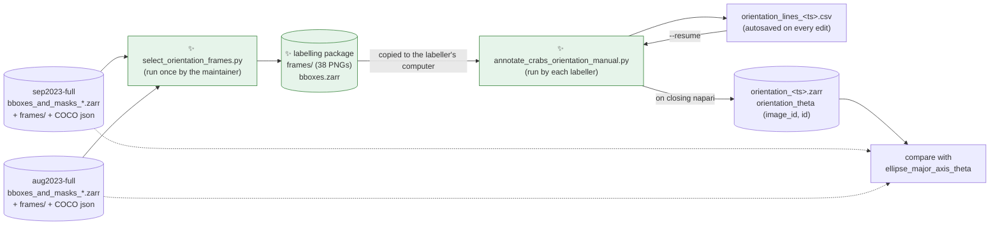
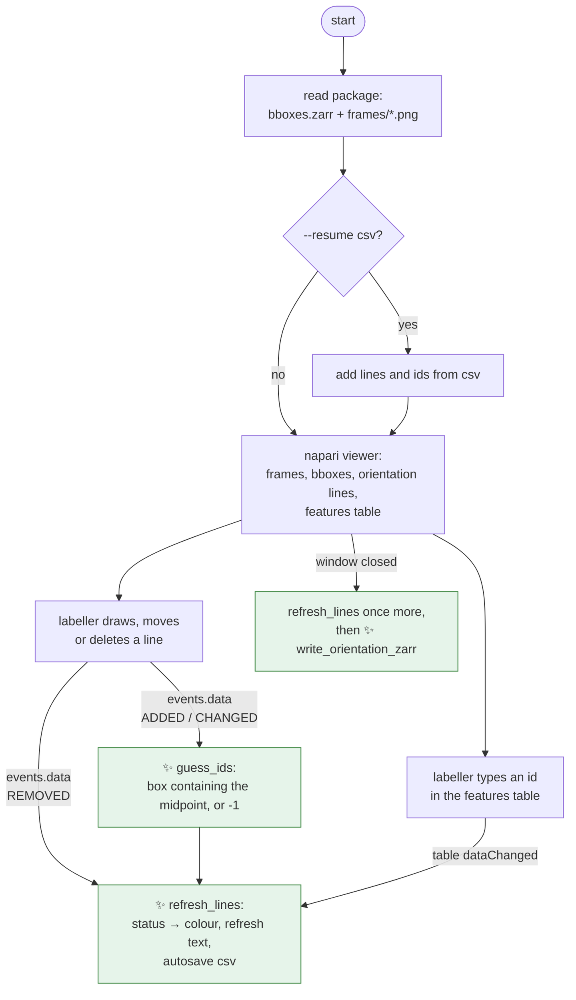

# Proposal for manual labelling of crab orientation in napari

## Description

Two `uv` scripts and a user guide that let a labeller draw one line per crab in napari.

- The first script picks a small set of frames and packs them, with their boxes, into one folder.
- The second script turns the lines drawn in napari into an orientation angle per box.
- The angles are saved on the same `(image_id, id)` grid as the input boxes, so they can be compared
  with `ellipse_major_axis_theta`.



Solid arrows show data flowing between files and scripts. Dotted arrows show the input stores being
read again at comparison time. ✨ marks what is new in this PR.

Links from the diagram:

- *sep2023-full / aug2023-full stores*: written by `main` in
  [generate_masks_from_bboxes.py:445](https://github.com/SainsburyWellcomeCentre/crabs-exploration/blob/smg/gt-ellipses-prediction/scripts/generate_masks_from_bboxes.py#L445)
- *ellipse_major_axis_theta*: computed in `compute_mask_props`,
  [generate_masks_from_bboxes.py:292](https://github.com/SainsburyWellcomeCentre/crabs-exploration/blob/smg/gt-ellipses-prediction/scripts/generate_masks_from_bboxes.py#L292)

## References

- Draft workflow and open questions:
  [guides/ManualAnnotationOrientation.md](guides/ManualAnnotationOrientation.md) on
  `smg/orientation-labelling`. This PR rewrites that file as the user guide.
- Branch `smg/gt-ellipses-prediction`: writes the input stores with
  [generate_masks_from_bboxes.py](https://github.com/SainsburyWellcomeCentre/crabs-exploration/blob/smg/gt-ellipses-prediction/scripts/generate_masks_from_bboxes.py).
- Pattern to reuse for autosave and resume:
  [annotate_burrow_prompts_manual.py:139](https://github.com/SainsburyWellcomeCentre/crabs-exploration/blob/main/scripts/burrows/annotate_burrow_prompts_manual.py#L139)
  (`_autosave_napari_points`).
- How ethology numbers images:
  [ethology load_bboxes.py:494](https://github.com/neuroinformatics-unit/ethology/blob/v0.1.3/ethology/io/annotations/load_bboxes.py#L494)
  (checked in ethology 0.1.3).
- Open issues and PRs could not be listed: `gh` timed out from this machine. Check before opening
  the PR.

## Overview of steps

1. Add `scripts/orientation/select_orientation_frames.py`. It samples 2 frames per Right video and
   writes a labelling package.
2. Add `scripts/orientation/annotate_crabs_orientation_manual.py`. It opens the package in napari,
   links each line to a box, autosaves, resumes and writes the output zarr store.
3. Rewrite `guides/ManualAnnotationOrientation.md` as the step-by-step user guide.

## Key aspects of suggested implementation

### 1. Frames are selected beforehand and shipped as a small package

The labeller gets one folder of about 0.6 GB instead of two stores plus 16 GB of frames.

- The input stores do not hold the images. Each `frames/` folder is about 7.9 GB, and each frame
  is about 15 MB.
- 38 selected frames are about 570 MB.
- The selection is fixed once and shared by every labeller.
- The labelling script stays small. It only reads the package, and never reads the COCO file or the
  input stores.

```text
orientation_labelling_<timestamp>/
├── frames/                      # the 38 selected PNGs, copied unchanged
└── bboxes.zarr                  # boxes of those frames only
    ├── image_id  (image_id,)    # 0..37, in the sorted order of filename
    ├── id        (id,)          # padded to the largest input store (136)
    ├── filename        (image_id,)   e.g. "04.09.2023-01-Right_frame_003488.png"
    ├── video           (image_id,)   e.g. "04.09.2023-01-Right"
    ├── dataset         (image_id,)   "sep2023-full" | "aug2023-full"
    ├── source_image_id (image_id,)   image_id in the input store
    ├── position  (image_id, space, id)
    └── shape     (image_id, space, id)
```

The selection is stored as coordinates along `image_id`. That answers the draft's question: a
coordinate is enough, and it travels into the output store unchanged.

Sampling with a seed inside the labelling script is rejected in the table below.

| Option | Why worse |
|---|---|
| Sample with a seed inside the labelling script | Every labeller must download both stores and all 1094 frames. |
| Precompute a CSV of selected frames | Same download problem. The labelling script would also need the COCO file. |
| ✅ Precompute a package of frames and boxes | Chosen. |

### 2. Filenames come from the COCO file, not from the store's attributes

The root attributes of both input stores are empty. Checked on the local copies:

- `zarr.json` has `"attributes": {}` in both stores.
- So `map_image_id_to_filename`, which `get_image_paths` relies on, is missing.

Ethology defines `image_id` as the position of the image in the alphabetically sorted list of
`file_name` values in the COCO file
([load_bboxes.py:494](https://github.com/neuroinformatics-unit/ethology/blob/v0.1.3/ethology/io/annotations/load_bboxes.py#L494)).
The selection script rebuilds the map the same way, using only the standard library:

```python
coco = json.loads((store_path.parent / "VIA_JSON_combined_coco_gen.json").read_text())
filenames = sorted(img["file_name"] for img in coco["images"])
```

Two checks guard this. The script stops with an error if either fails:

- the number of filenames equals `ds.sizes["image_id"]`;
- the number of boxes per frame in the store equals the number of COCO annotations per image.

Both checks were run by hand on the two local stores, and both hold.

The likely cause of the empty attributes is in `smg/gt-ellipses-prediction`, and fixing it belongs
there. See [Points to discuss #5](#points-to-discuss).

### 3. A line is linked to the box that contains its midpoint

A line belongs to the box whose rectangle contains the line's midpoint.

- This is a point-in-rectangle test: four comparisons per box, with no geometry library.
- It matches what a labeller does: they draw the line over the crab, so its middle lands on the
  crab.
- Neighbouring boxes often overlap. A long line can cross two boxes even when the intended crab is
  obvious, but its midpoint usually lies in one box only.

> [!NOTE]
> The draft links lines by "the box the line mostly intersects". That needs clipping each segment
> against each rectangle. Midpoint linking gives the same answer for any line drawn mostly inside one
> box, with less code. See [Points to discuss #1](#points-to-discuss).

Each line has one feature, `id`.

- `id` matches the name of the `id` coordinate in the input stores. In ethology, `id` is the box's
  slot within a frame, not an identity tracked across frames, so the draft's word "individual" is
  not used.
- `-1` means "not linked".

Each line gets one of three statuses. The status sets its colour:

| Status | Colour | Rule | Saved to the zarr store? |
|---|---|---|---|
| `linked` | green | `id` is a box whose rectangle contains the midpoint, and no other line on the frame has the same `id` | yes |
| `ambiguous` | yellow | the midpoint is inside 2 or more boxes and `id` is `-1`; or another line on the frame has the same `id` | no |
| `unlinked` | red | the midpoint is inside no box; or `id` is a box that does not contain the midpoint | no |

`id` is guessed automatically when a line is drawn or moved:

- midpoint inside exactly 1 box: `id` is that box;
- otherwise: `id` is `-1`, and napari shows a warning.

The labeller fixes a yellow line by typing the right `id` in the features table.
The labeller fixes a red line by moving it into a box. The guess runs again after the move.

### 4. Two save files: a CSV during labelling, a zarr store at the end

Each file has one job:

- **`orientation_lines_<ts>.csv`** is the working file. It is autosaved on every edit, holds every
  line in every status, and is what `--resume` reads.
- **`orientation_<ts>.zarr`** is the result. It is written when the napari window closes, and holds
  green lines only.

The CSV autosave reuses the pattern of `_autosave_napari_points`
([annotate_burrow_prompts_manual.py:139](https://github.com/SainsburyWellcomeCentre/crabs-exploration/blob/main/scripts/burrows/annotate_burrow_prompts_manual.py#L139)):
write to a `.tmp` file, then `os.replace`.

- `os.replace` swaps a file atomically on Windows too. It cannot replace a non-empty directory on
  Windows, so a zarr store cannot be autosaved safely the same way.
- A crash loses nothing. `--resume <csv>` and closing the window writes the zarr store.

CSV columns, one row per line:

```text
image_id, id, x0, y0, x1, y1, orientation_theta, status
```

The `status` column is the log of red and yellow lines asked for in the draft. A separate log file
would repeat these rows. See [Points to discuss #2](#points-to-discuss).

### 5. The output store has the package's coordinates and one variable

```text
orientation_<ts>.zarr
├── image_id, id, filename, video, dataset, source_image_id    (copied from bboxes.zarr)
└── orientation_theta  (image_id, id) float64, NaN where no green line
```

`orientation_theta` uses the same convention as `ellipse_major_axis_theta`
([generate_masks_from_bboxes.py:292](https://github.com/SainsburyWellcomeCentre/crabs-exploration/blob/smg/gt-ellipses-prediction/scripts/generate_masks_from_bboxes.py#L292)):

- it is measured from the image x-axis towards the y-axis, in radians, in [0, π);
- the image y-axis points down, so a positive angle looks clockwise on screen.

```python
theta = np.mod(np.arctan2(y1 - y0, x1 - x0), np.pi)
```

The store keeps the `image_id` axis rather than `time`.

- Annotated frames are independent images, not a time series.
- `image_id` is what the input stores use, so the comparison needs no renaming.
- Switching both scripts to `time` belongs in the follow-up PR the draft mentions.

### 6. napari setup

The napari behaviour below was verified against the napari 0.7.0a3 source in the repo's `.venv`.

| Layer | Setup |
|---|---|
| `frames` | `dask.array.image.imread("frames/*.png")`, lazy, so 38 × 26 MB is not loaded at once |
| `bboxes` | rectangles, features `{"id": ...}`, `text="{id}"`, `editable = False` |
| `orientation lines` | `shape_type="line"`, mode `add_line`, features `{"id": int}`, `feature_defaults={"id": -1}`, `text="{id}"` |

The features table opens on start-up, with editing switched on:

```python
dock, table = viewer.window.add_plugin_dock_widget("napari", "Features table widget")
table.toggle.setChecked(True)  # the "editable" switch
```

Two napari facts drive the event wiring:

- Drawing a line emits a single `events.data` with `action=ADDED` on mouse release, after the end
  point is set (`Shapes._finish_drawing`). Moving a shape emits `CHANGED`, and deleting emits
  `REMOVED`.
- An edit in the features table is written into `layer.features` in place. **No layer event is
  emitted.** The script listens to the table's own `dataChanged` Qt signal instead. That signal is
  internal to the widget. See [Points to discuss #7](#points-to-discuss).

## Detailed implementation



Arrows are the order things happen in the labelling script. Edge labels name the event that
triggers the next step.

Links from the diagram:

- *refresh_lines* reuses the autosave pattern of `_autosave_napari_points`,
  [annotate_burrow_prompts_manual.py:139](https://github.com/SainsburyWellcomeCentre/crabs-exploration/blob/main/scripts/burrows/annotate_burrow_prompts_manual.py#L139)

| # | Change | Signature |
|---|---|---|
| 1 | Read a store and label each frame with its filename | `load_store_with_filenames(store_path: Path) -> xr.Dataset` |
| 2 | Keep one camera and sample frames per video | `select_frames(ds: xr.Dataset, camera: str, frames_per_video: int, seed: int) -> xr.Dataset` |
| 3 | Copy frames and write `bboxes.zarr` | `write_package(ds: xr.Dataset, frames_dirs: dict[str, Path], output_dir: Path) -> Path` |
| 4 | Box rectangles for napari, one `id` per rectangle | `bboxes_to_napari_shapes(ds: xr.Dataset) -> tuple[list[np.ndarray], np.ndarray]` |
| 5 | Ids of the boxes containing a point | `boxes_containing(ds: xr.Dataset, image_id: int, x: float, y: float) -> np.ndarray` |
| 6 | Guess `id` for drawn or moved lines | `guess_ids(layer: Shapes, indices: list[int], ds: xr.Dataset) -> None` |
| 7 | Status of every line | `line_status(layer: Shapes, ds: xr.Dataset) -> np.ndarray` |
| 8 | Recolour, refresh text, autosave | `refresh_lines(layer: Shapes, ds: xr.Dataset, autosave_csv: Path) -> None` |
| 9 | Lines ↔ CSV rows | `lines_to_dataframe(layer, status) -> pd.DataFrame`, `dataframe_to_lines(df) -> tuple[list[np.ndarray], np.ndarray]` |
| 10 | Write the result | `write_orientation_zarr(df: pd.DataFrame, ds: xr.Dataset, path: Path) -> None` |
| 11 | User guide | rewrite `guides/ManualAnnotationOrientation.md` |

<details><summary><b>Steps 1–3: select_orientation_frames.py</b></summary>

Command line:

```text
uv run select_orientation_frames.py STORE [STORE ...]
    [--output-dir .] [--camera Right] [--frames-per-video 2] [--seed 42]
```

- `STORE` is a `bboxes_and_masks_*.zarr` path. Its data directory is `STORE.parent.parent`, which
  holds `frames/` and `annotations/VIA_JSON_combined_coco_gen.json`. This is the layout
  `generate_masks_from_bboxes.py` already expects.
- Dependencies: `numpy`, `pandas`, `xarray`, `zarr`, `dask`. No ethology: the only thing it would
  give is the COCO loader, and the script needs just the sorted filenames from the COCO file.

```python
FOR EACH store_path IN args.stores:
    ds = xr.open_zarr(store_path)[["position", "shape"]].load()
    filenames = sorted(file_name of each COCO image)
    CHECK len(filenames) == ds.sizes["image_id"]
    CHECK boxes per frame == COCO annotations per image
    ds = ds.assign_coords(
        filename=("image_id", filenames),
        video=("image_id", [f.split("_frame")[0] for f in filenames]),
        dataset=("image_id", [data_dir.name] * n),
        source_image_id=("image_id", ds.image_id.values),
    )
    keep frames whose video contains f"-{camera}"

ds = xr.concat(per_store, dim="image_id")      # pads `id` with NaN up to the widest store
sample `frames_per_video` frames per video     # pandas groupby("video").sample(random_state=seed)
sort the sample by filename, then set image_id = 0..N-1
copy each selected PNG into <package>/frames/
cast string coordinates to object, write <package>/bboxes.zarr
store seed, camera, frames_per_video, source stores and timestamp in the attrs
```

Expected result on the two local stores:

- 14 Right videos in `sep2023-full` and 5 in `aug2023-full`, so 19 videos.
- 2 frames each, so 38 frames.
- Every Right video has at least 5 annotated frames, so sampling 2 never runs short.

The image_id is reset to `0..N-1` in filename order for two reasons:

- the two stores both start at `image_id` 0, so the raw values clash;
- `dask.array.image.imread` reads `frames/*.png` in sorted order, so napari's frame index then
  equals `image_id` with no lookup table.

Rejected alternative:

| Option | Why worse |
|---|---|
| One package per input store, labelled in two sessions | Two sessions per labeller. The comparison is only slightly simpler. |

</details>

<details><summary><b>Steps 4–10: annotate_crabs_orientation_manual.py</b></summary>

Command line:

```text
uv run annotate_crabs_orientation_manual.py PACKAGE_DIR [--resume CSV]
```

- Outputs go to `PACKAGE_DIR/labels/`, next to the frames, so a labeller on Windows finds them
  without searching.
- Every session writes a new timestamped CSV. `--resume` reads an old CSV but never overwrites it,
  as in the burrow script.
- Dependencies: `napari[pyqt5]` (pinned, see [Points to discuss #7](#points-to-discuss)), `numpy`,
  `pandas`, `xarray`, `zarr`, `dask`, `Pillow`.

Start-up check: the sorted names in `frames/` must equal `ds.filename`. Otherwise the script stops
with an error, because a frame would show the wrong boxes.

Event handlers:

```python
def on_lines_data(event):
    IF event.action == ADDED:
        guess_ids(layer, [len(layer.data) - 1], ds)      # data_indices is (-1,)
    ELIF event.action == CHANGED:
        guess_ids(layer, list(event.data_indices), ds)
    ELIF event.action != REMOVED:
        return                                           # skip ADDING / CHANGING / REMOVING
    refresh_lines(layer, ds, autosave_csv)

layer.events.data.connect(on_lines_data)
table.table.model().sourceModel().dataChanged.connect(
    lambda *_: refresh_lines(layer, ds, autosave_csv)
)
napari.run()                          # blocks until the window is closed
refresh_lines(layer, ds, autosave_csv)
write_orientation_zarr(pd.read_csv(autosave_csv), ds, zarr_path)
```

- The table's `dataChanged` handler is connected after the widget's own write-back handler. Qt
  calls them in connection order, so `layer.features` is already updated when `refresh_lines` runs.
- `refresh_lines` sets `layer.edge_color` from the statuses, calls `layer.refresh_text()`, and
  autosaves the CSV.
- `guess_ids` shows a napari warning for each new red or yellow line.
- Moving a line runs the guess again, so a hand-typed `id` is replaced. This keeps one rule ("the
  line's position decides"). The user guide says so.

`write_orientation_zarr`:

```python
theta = np.full((n_image_id, n_id), np.nan)
FOR EACH green row IN df:
    theta[row.image_id, position of row.id] = row.orientation_theta
xr.Dataset({"orientation_theta": (("image_id", "id"), theta)}, coords=ds.coords)
    .drop_vars(["space"]).to_zarr(path)
```

Attributes on the output store: `package_dir`, `lines_csv`, `timestamp`, `napari_version`, and a
one-line description of the angle convention.

Comparison, for the user guide and later analysis:

```python
out = xr.open_zarr("orientation_<ts>.zarr")
src = xr.open_zarr("<sep2023-full store>")
sub = out.where(out.dataset == "sep2023-full", drop=True)
ellipse = src.ellipse_major_axis_theta.sel(image_id=sub.source_image_id).reindex(id=sub.id)
error = np.abs(np.mod(sub.orientation_theta - ellipse + np.pi / 2, np.pi) - np.pi / 2)
```

The error is computed modulo π, because a line and an ellipse axis have no head or tail.

Rejected alternatives:

| Option | Why worse |
|---|---|
| Autosave straight into the zarr store | A directory cannot be swapped atomically on Windows, so a crash mid-write could corrupt the store. |
| Re-check statuses on a timer instead of on events | Recolours shapes while the labeller is still dragging. |
| Load all frames into memory, as the burrow script does | About 1 GB of RAM for 38 frames of 4096 × 2160 × 3. |

</details>

<details><summary><b>Step 11: user guide</b></summary>

`guides/ManualAnnotationOrientation.md` is rewritten for a labeller on Windows who may not have
Python. Its sections:

1. **Install uv.** `uv` downloads a suitable Python by itself, so no Python install is needed.
2. **Download the script.** `curl.exe -LO <raw GitHub URL>` in PowerShell. Plain `curl` in
   PowerShell is an alias for `Invoke-WebRequest`, which takes different options.
3. **Copy the labelling package from ceph.** One folder, about 0.6 GB.
4. **Run the script.** `uv run annotate_crabs_orientation_manual.py <package>`.
5. **Label.** Draw one line per box, parallel to the crab's long axis. Colours, the features table,
   and how to fix yellow and red lines. Shortcuts for hiding the boxes (`V`, `Shift + V`).
6. **Stop and resume.** Close the window to finish. If napari crashes, run again with `--resume`.
7. **Send back** the `labels/` folder.
8. **For the maintainer:** how to run `select_orientation_frames.py` on ceph.

</details>

## Files changed

| File | Change |
|---|---|
| `scripts/orientation/select_orientation_frames.py` | **new**, about 120 lines |
| `scripts/orientation/annotate_crabs_orientation_manual.py` | **new**, about 300 lines |
| `guides/ManualAnnotationOrientation.md` | rewritten from the draft into the user guide |

The scripts go in a new `scripts/orientation/` folder rather than `scripts/burrows/`, because they
are not about burrows. The draft's download URL changes to match.

## Tests

No tests in this PR, as agreed. Manual checks are listed in
[Verifications for agent to run](#verifications-for-agent-to-run).

## Documentation updates

Yes: `guides/ManualAnnotationOrientation.md` is rewritten. It also fixes two problems in the draft's
ceph paths:

- the two timestamps are swapped: locally, `sep2023-full` is `…_194318` and `aug2023-full` is
  `…_200236`;
- the paths are missing the `annotations/` folder.

## Gotchas

| Detail | Consequence | Handling |
|---|---|---|
| Input stores have empty root attributes | `get_image_paths` cannot be used | Filenames rebuilt from COCO, with two checks ([§2](#2-filenames-come-from-the-coco-file-not-from-the-stores-attributes)) |
| Features-table edits emit no layer event | Colours and autosave would miss typed ids | Listen to the table's `dataChanged`, and autosave once more after `napari.run()` |
| `bboxes` features are editable in the table if that layer is selected | Box labels on screen can be changed by mistake | The output never reads them: boxes come from `bboxes.zarr`. The `orientation lines` layer is selected on start-up. |
| zarr 3 has no stable format for fixed-width numpy strings | Writing `filename`, `video`, `dataset` could fail | Cast them to `object` before `to_zarr`, as `create_dataset_store` does for `space` |
| `layer.editable` is reset when a shapes layer's data is set | `bboxes` would become editable | The script never sets `bboxes` data after creating the layer |

## Verifications for agent to run

Sample data is available locally:

- `/Users/sofia/swc/CrabLabels/sep2023-full/annotations/bboxes_and_masks_20261015_194318.zarr`
- `/Users/sofia/swc/CrabLabels/aug2023-full/annotations/bboxes_and_masks_20261015_200236.zarr`

1. Build a package and check it has 38 frames, from 19 Right videos, 2 per video:

    ```text
    uv run scripts/orientation/select_orientation_frames.py \
        /Users/sofia/swc/CrabLabels/sep2023-full/annotations/bboxes_and_masks_20261015_194318.zarr \
        /Users/sofia/swc/CrabLabels/aug2023-full/annotations/bboxes_and_masks_20261015_200236.zarr \
        --output-dir $TMPDIR
    ```

2. Run it again with the same seed and check the selection is identical.
3. Check by eye, on 3 frames, that the boxes in napari sit on the crabs.
4. Draw one green, one yellow and one red line. Check the colours and the warnings.
5. Fix the yellow line in the features table. Check it turns green and the CSV updates.
6. Kill the process. Run again with `--resume <csv>`, and check all lines come back.
7. Close the window. Open the zarr store and check `orientation_theta` has exactly one value per
   green line, and that a horizontal line gives θ ≈ 0 and a line drawn down-right gives θ ≈ π/4.
8. Run the comparison snippet from the *Steps 4–10* details against the sep store.
9. `pre-commit run --files scripts/orientation/*.py guides/ManualAnnotationOrientation.md`

These checks need a display, so they are run by the user or with the `run` skill.

## Points to discuss

| # | To discuss | Conclusion |
|---|---|---|
| 1 | **Midpoint or overlap linking.** The draft links a line to the box it mostly overlaps. Recommend the midpoint rule ([§3](#3-a-line-is-linked-to-the-box-that-contains-its-midpoint)): same result for well-placed lines, a few lines of code instead of segment clipping. | Agreed, I prefer a simpler solution. |
| 2 | **No separate log file.** The `status` column of the lines CSV records every red and yellow line. Recommend no extra file. | to discuss|
| 3 | **Package instead of the full stores.** Labellers copy about 0.6 GB instead of 16 GB, and never need the COCO file. Recommend the package ([§1](#1-frames-are-selected-beforehand-and-shipped-as-a-small-package)). | Agreed |
| 4 | **Labelling more frames later.** Not in this PR. The simplest extension is `--exclude-package <old bboxes.zarr>` on the selection script, which drops already-used filenames before sampling (about 5 lines). | Make a note on the PR description when opened under "Future work". |
| 5 | **Empty root attributes in the input stores.** Probably caused by `ds_props.to_zarr(output_zarr, mode="a")` ([generate_masks_from_bboxes.py:538](https://github.com/SainsburyWellcomeCentre/crabs-exploration/blob/smg/gt-ellipses-prediction/scripts/generate_masks_from_bboxes.py#L538)) replacing the root attributes with those of `ds_props`, which are empty. Not verified. Recommend fixing it in `smg/gt-ellipses-prediction`; this PR does not depend on the attributes. | Yes, this should be fixed separately. |
| 6 | **`image_id` or `time`.** Recommend keeping `image_id` here, and switching both scripts together in a follow-up PR. | image_id makes more sense for annotations. |
| 7 | **napari version and the features table.** The table's `dataChanged` and `toggle` are internal to `napari_builtins`, checked only in napari 0.7.0a3. Recommend pinning `napari[pyqt5]` to the stable release tested during implementation. | to discuss|
| 8 | **Output variable.** Recommend only `orientation_theta`, named to sit next to `ellipse_major_axis_theta`. The boxes are already in `bboxes.zarr`. | Suggested rename to `segment_theta`|
| 9 | **Several labellers.** Not in this PR. Adding `--annotator NAME`, saved in the output attributes and filenames, would let results from several labellers be compared. | Please implement as part of this PR|
| 10 | **Running the script straight from its URL.** `uv run <raw GitHub URL>` would remove the download step. Not checked against the uv version labellers will install; recommend the explicit download in the guide for now. | ok |
| 11 | **Sampling settings.** Recommend Right camera only, 2 frames per video, seed 42. This gives 38 frames from 19 videos, even though videos have between 5 and 50 annotated frames. | ok |
